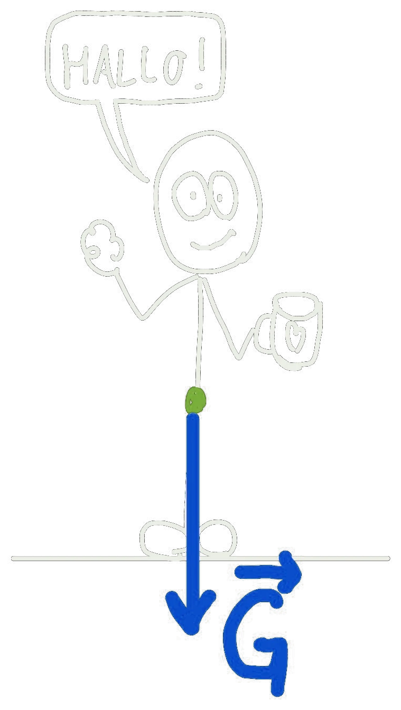

Vanlig tekst skrives som her. **Fet**, *kursiv*, og formler med dollartegn: $F = ma$, eller på egen linje:

$$
W = F \, s \cos\theta
$$

## Video



## Bokser

::: {.callout-note title="Definisjon: Arbeid"}
Arbeid er kraft ganger forflytning i kraftens retning.
:::

::: {.callout-tip title="Tips"}
Tegn alltid en figur først.
:::

::: {.eksempel}
**Eksempel:** En kasse dras 5 m med en kraft på 20 N. Arbeidet er $W = 20 \cdot 5 = 100$ J.
:::

## Steg og kort i stedet for punktlister

Vanlige punktlister blir fort kjedelige. Bruk heller en av disse (eller en TikZ-figur):

::: {.steg}
1. **Tegn** situasjonen.
2. **Skriv opp** det du vet.
3. **Regn ut** og sjekk enheten.
:::

::: {.kort}
- **Elastisk støt** Både bevegelsesmengde og kinetisk energi er bevart.
- **Uelastisk støt** Bare bevegelsesmengden er bevart.
:::

## Oppgaver med løsning og KI-hint

:::: {.oppgaver}

::: {.oppgave tittel="Kjelke i snøen"}
Du drar en kjelke 10 m med en kraft på 50 N i 30° vinkel med bakken. Hvor stort arbeid gjør du?

::: {.losning}
$W = F s \cos\theta = 50 \cdot 10 \cdot \cos 30^\circ \approx 433$ J
:::
:::

::::

## Kode studentene kan kjøre

```{.python .kjor}
import numpy as np
F, s, theta = 50, 10, np.radians(30)
print("W =", round(F * s * np.cos(theta)), "J")
```

## Bilder og tegninger

Legg bildet i mappen `bilder/` og vis det slik:



Nettsidene har lys og mørk modus, så bilder skal ikke ha hvit bakgrunn. TikZ-figurer tegnes svart på gjennomsiktig bakgrunn og merkes `{.tikz-fig}`. Skannede bilder merkes `{.kompendium-bilde}`, fargefigurer i tillegg `.farge` og fotografier `.foto` (se `AGENTS.md` i Plattform).
