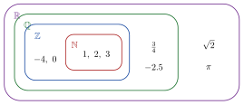

<!-- video: kommer (videoer/matte-forkurs/01-01-tall-og-tallregning) -->
{fig-alt="Video kommer"}

<!-- tillegg: Claude -->
Før vi kan løse likninger og derivere funksjoner, må vi kunne regne sikkert med tall. Det handler om to ting: hvilke tall som finnes, og i hvilken rekkefølge vi regner. Mange feil i matematikk og fysikk skyldes ikke vanskelig teori, men en minusfortegn som forsvant eller en parentes som ble regnet i feil rekkefølge.

## Tallmengdene

Tallene vi bruker, kan sorteres i mengder der hver mengde inneholder den forrige:

::: {.kort}
- **Naturlige tall $\mathbb{N}$** $1, 2, 3, \dots$ Tallene vi teller med.
- **Hele tall $\mathbb{Z}$** $\dots, -2, -1, 0, 1, 2, \dots$ De naturlige tallene, null og de negative tallene.
- **Rasjonale tall $\mathbb{Q}$** Alle tall som kan skrives som en brøk $\frac{p}{q}$ med hele tall $p$ og $q \neq 0$, for eksempel $\frac34$, $-2.5$ og $0.333\ldots$
- **Reelle tall $\mathbb{R}$** Alle tall på tallinja, også de som ikke kan skrives som brøk, som $\sqrt2$ og $\pi$. Disse kalles irrasjonale.
:::

Et rasjonalt tall har en desimalutvikling som enten stopper ($\frac34 = 0.75$) eller gjentar seg ($\frac13 = 0.333\ldots$). Et irrasjonalt tall har uendelig mange desimaler uten mønster: $\pi = 3.14159\ldots$

<!-- tillegg: Claude -->
{.tikz-fig style="width:420px"}

## Regnerekkefølge

Når et uttrykk har flere regneoperasjoner, regner vi alltid i denne rekkefølgen:

::: {.steg}
1. **Parenteser** regnes ut først, innerst først.
2. **Potenser** (og røtter).
3. **Multiplikasjon og divisjon**, fra venstre mot høyre.
4. **Addisjon og subtraksjon**, fra venstre mot høyre.
:::

En brøkstrek virker som en parentes rundt både teller og nevner.

::: {.eksempel}
**Eksempel: Regnerekkefølge.** Regn ut a) $3 + 4\cdot 2^2$ og b) $\dfrac{12 - 2\cdot 3}{4 - 1} + (5 - 7)\cdot 3$.

::: {.losning}
a) Potensen først, så multiplikasjonen, så addisjonen:
$$
3 + 4\cdot 2^2 = 3 + 4\cdot 4 = 3 + 16 = \underline{\underline{19}}
$$

b) Brøkstreken virker som parentes rundt teller og nevner:
$$
\frac{12 - 6}{3} + (-2)\cdot 3 = \frac{6}{3} - 6 = 2 - 6 = \underline{\underline{-4}}
$$
:::
:::

## Fortegnsregler

Når vi ganger eller deler, gir like fortegn pluss og ulike fortegn minus:

::: {.graa}
$$
(+)\cdot(+) = +\qquad (-)\cdot(-) = +\qquad (+)\cdot(-) = -\qquad (-)\cdot(+) = -
$$
:::

To minustegn etter hverandre blir pluss: $5 - (-3) = 5 + 3 = 8$.

::: {.callout-warning title="Minus og potenser"}
$-3^2$ betyr $-(3^2) = -9$, fordi potensen regnes før minustegnet. Vil du kvadrere $-3$, må du skrive $(-3)^2 = 9$. Kalkulatorer og Python følger samme regel: `-3**2` gir `-9`.
:::

## Overslag

Et **overslag** er en rask, grov utregning med avrundede tall. Den forteller deg omtrent hva svaret skal bli, slik at du oppdager tastefeil. Rund av til tall som er lette å regne med:
$$
\frac{48.7\cdot 9.81}{2.1} \approx \frac{50\cdot 10}{2} = 250
$$
Det nøyaktige svaret er $227.5$. Overslaget viser at svaret skal være et par hundre, ikke $2.3$ eller $2300$.

::: {.eksempel}
<!-- tillegg: Claude -->
**Eksempel: Fortegn og overslag.** a) Regn ut $(-3)\cdot(-4) - (-2)^3 : 4$. b) Gjør et overslag over $48.7\cdot0.21$, og sammenlign med det nøyaktige svaret.

::: {.losning}
**a)** Potensen først: $(-2)^3 = -8$. Så ganging og deling: $(-3)\cdot(-4) = 12$ og $-8 : 4 = -2$. Til slutt:
$$
12 - (-2) = \underline{\underline{14}}
$$
**b)** Rund av til tall som er lette å regne med: $48.7\cdot0.21 \approx 50\cdot0.2 = \underline{\underline{10}}$. Det nøyaktige svaret er $10.227$, så overslaget er godt. Et overslag avslører tastefeil: Viser kalkulatoren $102.27$, har du trykket feil.
:::
:::

## Prøv selv

Python følger de samme reglene for regnerekkefølge. Potens skrives `**`. Endre uttrykkene og trykk **Kjør**.

```{.python .kjor}
print(3 + 4 * 2**2)                      # 19
print((12 - 2*3) / (4 - 1) + (5 - 7)*3)  # -4.0
print(-3**2, (-3)**2)                    # -9 og 9
print(48.7 * 9.81 / 2.1)                 # sammenlign med overslaget 250
```

:::: {.oppgaver}

::: {.oppgave tittel="Regnerekkefølge"}
Regn ut uten kalkulator: a) $8 - 2\cdot 3 + 1$ b) $(8 - 2)\cdot(3 + 1)$ c) $20 : 4\cdot 5$ d) $2\cdot 3^2 - (4 - 6)^3$

::: {.fasit}
a) $3$ · b) $24$ · c) $25$ · d) $26$
:::
:::

::: {.oppgave tittel="Hvilken tallmengde?"}
Hvilken minste tallmengde ($\mathbb{N}$, $\mathbb{Z}$, $\mathbb{Q}$ eller $\mathbb{R}$) hører tallene til? a) $-7$ b) $0.125$ c) $\sqrt{16}$ d) $\sqrt{5}$ e) $0.\overline{6}$ (altså $0.666\ldots$)

:::

::: {.oppgave tittel="Brøkstrek som parentes"}
Regn ut $\dfrac{3 + 5\cdot 2}{2^2 - 3} - 4\cdot(1 - 3)$.

::: {.fasit}
$21$
:::
:::

::: {.oppgave tittel="Overslag" niva="Middels"}
Gjør et overslag før du regner nøyaktig: a) $\dfrac{0.48\cdot 312}{5.9}$ b) $9.81\cdot 3.2^2 / 2$. Regn deretter ut svarene med kalkulator eller Python, og sammenlign.

::: {.fasit}
a) $25.4$ · b) $50.2$
:::
:::

::::
