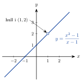

<!-- video: kommer (videoer/matte-forkurs/01-04-rasjonale-uttrykk) -->
{fig-alt="Video kommer"}

<!-- tillegg: Claude -->
Et **rasjonalt uttrykk** er en brøk der det står bokstaver i telleren eller nevneren, for eksempel $\dfrac{3}{x}$ eller $\dfrac{x + 1}{x^2 - 4}$. Vi regner med dem på nøyaktig samme måte som med tallbrøker. Det eneste nye er at vi må passe på at nevneren ikke blir null.

## Når er uttrykket definert?

Vi kan ikke dele på null. Uttrykket $\dfrac{5}{x - 2}$ er derfor ikke definert for $x = 2$. Skriv alltid opp hvilke verdier som er forbudt, før du begynner å regne:
$$
\frac{5}{x - 2}, \quad x \neq 2
$$

## Forkorting

Vi kan forkorte med en **faktor** som står i både telleren og nevneren:
$$
\frac{6x^2}{9x} = \frac{2x\cdot 3x}{3\cdot 3x} = \frac{2x}{3}, \quad x \neq 0
$$
Regelen er den samme som for tallbrøker: Bare faktorer kan forkortes, aldri ledd. I $\dfrac{x + 3}{x}$ kan $x$-ene **ikke** strykes, fordi $x$ i telleren er et ledd.

<!-- tillegg: Claude -->
{.tikz-fig style="width:320px"}

## Fellesnevner

For å legge sammen rasjonale uttrykk finner vi en fellesnevner, akkurat som med tall. Fellesnevneren må inneholde alle faktorene i alle nevnerne.

::: {.steg}
1. Finn alle faktorene i nevnerne.
2. Lag fellesnevneren av alle faktorene.
3. Utvid hver brøk så den får fellesnevneren.
4. Legg sammen tellerne, og forenkle.
:::

::: {.eksempel}
**Eksempel: Fellesnevner med bokstaver.** Skriv som én brøk: $\dfrac{2}{x} + \dfrac{3}{x + 1}$.

::: {.losning}
Nevnerne er $x$ og $x + 1$. Fellesnevneren er $x(x + 1)$. Vi utvider:
$$
\frac{2(x + 1)}{x(x + 1)} + \frac{3x}{x(x + 1)} = \frac{2x + 2 + 3x}{x(x + 1)} = \underline{\underline{\frac{5x + 2}{x(x + 1)}}}, \quad x \neq 0,\ x \neq -1
$$
:::
:::

::: {.eksempel}
**Eksempel: Gange og dele.** Forenkle $\dfrac{4x}{y^2}\cdot\dfrac{3y}{2x^2}$.

::: {.losning}
Gang teller med teller og nevner med nevner, og forkort felles faktorer:
$$
\frac{4x\cdot 3y}{y^2\cdot 2x^2} = \frac{12xy}{2x^2y^2} = \underline{\underline{\frac{6}{xy}}}, \quad x \neq 0,\ y \neq 0
$$
:::
:::

Senere, i kapitlet om faktorisering, lærer vi å forkorte uttrykk som $\dfrac{x^2 - 4}{x - 2}$ ved å faktorisere telleren først.

## Prøv selv

`sympy` kan sette sammen brøker med `together` og forkorte med `cancel`. Prøv dine egne uttrykk.

```{.python .kjor}
from sympy import symbols, together, cancel

x, y = symbols("x y")
print(together(2/x + 3/(x + 1)))          # (5*x + 2)/(x*(x + 1))
print(cancel(4*x/y**2 * 3*y/(2*x**2)))    # 6/(x*y)
```

:::: {.oppgaver}

::: {.oppgave tittel="Forbudte verdier"}
For hvilke verdier av $x$ er uttrykkene ikke definert? a) $\dfrac{1}{x + 5}$ b) $\dfrac{x}{2x - 6}$ c) $\dfrac{3}{x(x - 1)}$

::: {.fasit}
a) $x = -5$ · b) $x = 3$ · c) $x = 0 \text{ og } x = 1$
:::
:::

::: {.oppgave tittel="Forkort"}
Forkort: a) $\dfrac{8a^3}{12a}$ b) $\dfrac{15x^2y}{5xy^2}$

::: {.fasit}
a) $\dfrac{2a^2}{3}$ · b) $\dfrac{3x}{y}$
:::
:::

::: {.oppgave tittel="Fellesnevner"}
Skriv som én brøk: a) $\dfrac{1}{x} + \dfrac{1}{2x}$ b) $\dfrac{3}{x} - \dfrac{2}{x - 4}$

::: {.fasit}
a) $\dfrac{3}{2x}$ · b) $\frac{x - 12}{x(x - 4)}$
:::
:::

::: {.oppgave tittel="Linselikningen" niva="Middels"}
For en linse gjelder $\dfrac{1}{f} = \dfrac{1}{a} + \dfrac{1}{b}$, der $a$ er avstanden til tingen og $b$ avstanden til bildet. Skriv høyre side som én brøk, og vis at $f = \dfrac{ab}{a + b}$.

:::

::: {.oppgave tittel="Tre brøker" niva="Utfordrende"}
Skriv som én brøk og forenkle: $\dfrac{2}{x} - \dfrac{1}{x + 2} + \dfrac{4}{x(x + 2)}$

::: {.fasit}
$\frac{x + 8}{x(x + 2)}$
:::
:::

::::
