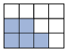

<!-- tillegg: Claude -->
Oppgavene blander alt fra tallregning til røtter, slik det blir på en prøve. Prøv selv før du åpner løsningen.

:::: {.oppgaver}

::: {.oppgave tittel="Regnerekkefølge med brøker" krever="tall-og-regneregler/brokregning"}
Regn ut uten kalkulator: $\dfrac{2}{3} + \dfrac{1}{3}\cdot\left(\dfrac{3}{2}\right)^2$

::: {.fasit}
$\frac{17}{12}$
:::
:::

::: {.oppgave tittel="Parenteser og potenser" krever="tall-og-regneregler/bokstavregning"}
Forenkle $(x + 2)^2 - x(x + 4)$.

::: {.fasit}
$4$
:::
:::

::: {.oppgave tittel="Potenser av ti" krever="tall-og-regneregler/standardform, tall-og-regneregler/potenser"}
Regn ut og svar på standardform: $\dfrac{(3.0\cdot 10^{4})^2\cdot 2.0\cdot 10^{-3}}{6.0\cdot 10^{2}}$

::: {.fasit}
$3.0\cdot 10^{3}$
:::
:::

::: {.oppgave tittel="Brøk med bokstaver" niva="Middels" krever="tall-og-regneregler/brokregning, tall-og-regneregler/bokstavregning"}
Skriv som én brøk og forkort: $\dfrac{a}{b} - \dfrac{b}{a}$, og regn deretter ut verdien for $a = 3$ og $b = 2$ på to måter.

::: {.fasit}
$\frac{a^2 - b^2}{ab}$
:::
:::

::: {.oppgave tittel="Røtter og potenser" niva="Middels" krever="tall-og-regneregler/potenser, tall-og-regneregler/rotter"}
Skriv som én potens av 2: $\dfrac{\sqrt{8}\cdot 4^{3}}{2^{-1}}$

::: {.fasit}
$2^{17/2}$
:::
:::

::: {.oppgave tittel="Avstand til Månen" niva="Middels" krever="tall-og-regneregler/standardform"}
En laserpuls sendes til Månen og reflekteres tilbake. Det tar $2.56\ \mathrm{s}$ fram og tilbake. Lysfarten er $3.00\cdot 10^8\ \mathrm{m/s}$. Hvor langt er det til Månen? Svar på standardform.

::: {.fasit}
$3.84\cdot 10^8\ \mathrm{m}$
:::
:::

::: {.oppgave tittel="Alt på en gang" niva="Utfordrende" krever="tall-og-regneregler/potenser, tall-og-regneregler/rotter"}
Forenkle så mye som mulig, og skriv uten negative eksponenter og uten rot i nevneren:
$$
\frac{\sqrt{12x^3}}{(3x)^{-1}\cdot\sqrt{3x}}, \qquad x > 0
$$

::: {.fasit}
$6x^2$
:::
:::

::: {.oppgave tittel="Les av figuren" krever="tall-og-regneregler/brokregning"}
<!-- tillegg: Claude -->
{.tikz-fig style="width:160px"}

a) Hvor stor brøkdel av rektangelet er farget? b) Hvor mye blir det hvis vi farger $\frac13$ av rektangelet i tillegg?

::: {.fasit}
$\frac{5}{12}$ · $\frac34$
:::
:::

::::
