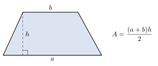

<!-- video: kommer (videoer/matte-forkurs/02-03-formler) -->
{fig-alt="Video kommer"}

<!-- tillegg: Claude -->
En formel er en likning som sier hvordan størrelser henger sammen, som $A = \pi r^2$ eller $s = vt$. Ofte kjenner vi alle størrelsene unntatt én, og da må vi **snu formelen**: løse den med hensyn på den størrelsen vi vil finne. Det er den samme likningsløsningen som før, bare med bokstaver i stedet for tall.

## Å bruke en formel

Sett inn tallene med enheter, og regn ut. Formelen for arealet av et trapes er $A = \dfrac{(a + b)h}{2}$. Med $a = 6.0\ \mathrm{cm}$, $b = 4.0\ \mathrm{cm}$ og $h = 3.0\ \mathrm{cm}$ blir
$$
A = \frac{(6.0 + 4.0)\ \mathrm{cm}\cdot 3.0\ \mathrm{cm}}{2} = 15\ \mathrm{cm^2}
$$

## Å snu en formel

Vi bruker de samme reglene som for likninger: Gjør det samme på begge sider, til den ukjente står alene.

::: {.steg}
1. Bestem hvilken størrelse du skal finne.
2. Fjern brøker ved å gange med nevneren.
3. Samle leddene med den ukjente på én side.
4. Del (eller ta roten) til den ukjente står alene.
:::

<!-- tillegg: Claude -->
{.tikz-fig style="width:400px"}

::: {.eksempel}
**Eksempel: Snu trapesformelen.** Løs $A = \dfrac{(a + b)h}{2}$ med hensyn på $b$.

::: {.losning}
Gang med 2: $2A = (a + b)h$. Del på $h$: $\dfrac{2A}{h} = a + b$. Trekk fra $a$:
$$
\underline{\underline{b = \frac{2A}{h} - a}}
$$
Kontroll med tallene over: $\frac{2\cdot 15}{3.0} - 6.0 = 10 - 6.0 = 4.0$. Det stemmer.
:::
:::

::: {.eksempel}
**Eksempel: Kvadrat i formelen.** Den kinetiske energien er $E_\mathrm{k} = \frac12 mv^2$. Løs med hensyn på $v$.

::: {.losning}
Gang med 2 og del på $m$: $v^2 = \dfrac{2E_\mathrm{k}}{m}$. Ta kvadratroten (farten er positiv):
$$
\underline{\underline{v = \sqrt{\frac{2E_\mathrm{k}}{m}}}}
$$
:::
:::

::: {.callout-tip title="Sjekk med enheter"}
En snudd formel må gi riktig enhet. I eksemplet over er $\sqrt{\mathrm{J}/\mathrm{kg}} = \sqrt{\mathrm{kg\,m^2\,s^{-2}}/\mathrm{kg}} = \mathrm{m/s}$. Gir formelen feil enhet, har du gjort en feil.
:::

::: {.callout-tip title="I fysikken"}
Nesten alle fysikkoppgaver handler om å snu en formel. Se [likninger og algebra på fysikkhjelp.no](https://fysikkhjelp.no/fysikk-forkurs/kapitler/02-matematikk/01-likninger-og-algebra.html) og [et fullstendig regneeksempel](https://fysikkhjelp.no/fysikk-forkurs/kapitler/01-hva-er-fysikk/07-eksempel-pa-beregning.html).
:::

## Formler i Python

En formel kan skrives som en **funksjon** i Python. Da kan vi regne ut svaret for mange verdier uten å skrive formelen på nytt. `sympy` kan også snu formler for oss.

```{.python .kjor}
import numpy as np

def fart(E_k, m):
    """Farten fra kinetisk energi (J) og masse (kg)."""
    return np.sqrt(2 * E_k / m)

print(f"{fart(450, 1.0):.1f} m/s")      # 30.0 m/s
print(fart(np.array([100, 200, 400]), 2.0))

from sympy import symbols, solve, Eq
A, a, b, h = symbols("A a b h", positive=True)
print(solve(Eq(A, (a + b)*h/2), b))     # [2*A/h - a]
```

:::: {.oppgaver}

::: {.oppgave tittel="Bruk formelen"}
Volumet av en sylinder er $V = \pi r^2 h$. Regn ut volumet når $r = 3.0\ \mathrm{cm}$ og $h = 10\ \mathrm{cm}$.

::: {.fasit}
$2.8\cdot 10^2\ \mathrm{cm^3}$
:::
:::

::: {.oppgave tittel="Snu formelen"}
Løs med hensyn på den størrelsen som står i parentes: a) $s = vt$ ($t$) b) $F = ma$ ($a$) c) $P = 2a + 2b$ ($b$)

::: {.fasit}
$t = \dfrac{s}{v}$ · $a = \dfrac{F}{m}$ · $b = \dfrac{P - 2a}{2} = \dfrac P2 - a$
:::
:::

::: {.oppgave tittel="Temperatur" niva="Middels"}
Sammenhengen mellom grader fahrenheit og celsius er $F = \frac95 C + 32$. a) Løs formelen med hensyn på $C$. b) Hva er $98.6\ ^\circ\mathrm{F}$ i celsius? c) Ved hvilken temperatur viser begge skalaene samme tall?

::: {.fasit}
a) $C = \frac59(F - 32)$ · b) $37.0\ ^\circ\mathrm{C}$ · c) $C = -40$
:::
:::

::: {.oppgave tittel="Pendelen" niva="Middels"}
Svingetiden til en pendel er $T = 2\pi\sqrt{\dfrac{L}{\mathrm{g}}}$. Løs formelen med hensyn på $L$.

::: {.fasit}
$L = \frac{\mathrm{g}T^2}{4\pi^2}$
:::
:::

::: {.oppgave tittel="Ukjent i to ledd" niva="Utfordrende"}
Løs $y = \dfrac{x + 2}{x - 1}$ med hensyn på $x$.

::: {.fasit}
$x = \frac{y + 2}{y - 1}$
:::
:::

::::
