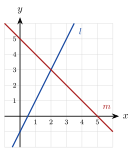

<!-- tillegg: Claude -->
Oppgavene blander likninger, likningssett, formler og ulikheter. Prøv selv før du åpner løsningen.

:::: {.oppgaver}

::: {.oppgave tittel="Likning med brøker" krever="algebra-og-likninger/likninger, tall-og-regneregler/brokregning"}
Løs $\dfrac{3x - 2}{4} - \dfrac{x}{6} = 1$.

::: {.losning}
Gang med 12: $3(3x - 2) - 2x = 12$, så $9x - 6 - 2x = 12$ og $7x = 18$. Da er $\underline{\underline{x = \dfrac{18}{7}}}$.
:::
:::

::: {.oppgave tittel="Snu formelen" krever="algebra-og-likninger/formler"}
Den gjennomsnittlige farten er $\bar v = \dfrac{v_0 + v}{2}$. Løs med hensyn på $v$, og finn $v$ når $\bar v = 12\ \mathrm{m/s}$ og $v_0 = 4.0\ \mathrm{m/s}$.

::: {.losning}
$2\bar v = v_0 + v$, så $v = 2\bar v - v_0$. Med tall: $v = 24 - 4.0 = \underline{\underline{20\ \mathrm{m/s}}}$.
:::
:::

::: {.oppgave tittel="Ulikhet og intervall" krever="algebra-og-likninger/ulikheter, algebra-og-likninger/intervall-og-mengder"}
Løs ulikheten og skriv svaret som intervall: $4 - 2(x + 1) > x - 7$.

::: {.losning}
$4 - 2x - 2 > x - 7$ gir $-3x > -9$, så $x < 3$. Intervallet er $\underline{\underline{\langle\leftarrow, 3\rangle}}$.
:::
:::

::: {.oppgave tittel="Blanding av kaffe" niva="Middels" krever="algebra-og-likninger/likningssett"}
En kaffebar blander kaffe til $180$ kr/kg med kaffe til $260$ kr/kg og vil ha $10$ kg til $212$ kr/kg. Hvor mye av hver sort trenger de?

::: {.losning}
La $x$ og $y$ være kilogram av hver sort: $x + y = 10$ og $180x + 260y = 2120$. Med $x = 10 - y$:
$$
1800 - 180y + 260y = 2120 \quad\Longrightarrow\quad 80y = 320 \quad\Longrightarrow\quad y = 4
$$
De trenger $\underline{\underline{6\ \mathrm{kg} \text{ til } 180 \text{ kr og } 4\ \mathrm{kg} \text{ til } 260 \text{ kr}}}$.
:::
:::

::: {.oppgave tittel="Dobbel ulikhet" niva="Middels" krever="algebra-og-likninger/ulikheter"}
For hvilke $x$ ligger $\dfrac{x + 1}{2}$ mellom $-1$ og $3$ (begge med)?

::: {.losning}
$-1 \le \frac{x + 1}{2} \le 3$. Gang med 2: $-2 \le x + 1 \le 6$. Trekk fra 1: $\underline{\underline{-3 \le x \le 5}}$, altså $x \in [-3, 5]$.
:::
:::

::: {.oppgave tittel="To tog" niva="Utfordrende" krever="algebra-og-likninger/likninger"}
To byer ligger $420\ \mathrm{km}$ fra hverandre. Et tog går fra den ene byen kl. 10.00 med $80\ \mathrm{km/h}$. Et annet tog går fra den andre byen kl. 11.00 med $100\ \mathrm{km/h}$, mot det første. Når og hvor møtes de?

::: {.losning}
La $t$ være timer etter kl. 10.00. Det første toget har kjørt $80t$, det andre $100(t - 1)$. De møtes når summen er 420:
$$
80t + 100(t - 1) = 420 \quad\Longrightarrow\quad 180t = 520 \quad\Longrightarrow\quad t = 2.89\ \mathrm{h}
$$
$2.89\ \mathrm{h} \approx 2$ timer og 53 minutter, så de møtes $\underline{\underline{\text{ca. kl. 12.53}}}$, $80\cdot 2.89 = \underline{\underline{231\ \mathrm{km}}}$ fra den første byen.
:::
:::

::: {.oppgave tittel="Løsning fra grafen" krever="algebra-og-likninger/likningssett"}
<!-- tillegg: Claude -->
{.tikz-fig style="width:280px"}

Finn likningene for linjene $l$ og $m$ fra figuren. Les av løsningen av likningssettet, og kontroller ved regning.

::: {.losning}
$l$ går gjennom $(0, -1)$ og $(2, 3)$: $\underline{\underline{y = 2x - 1}}$. $m$ går gjennom $(0, 5)$ og $(5, 0)$: $\underline{\underline{y = -x + 5}}$.

Skjæringspunktet er $(2, 3)$. Kontroll: $2x - 1 = -x + 5$ gir $3x = 6$, $x = 2$ og $y = 3$. ✓
:::
:::

::::
