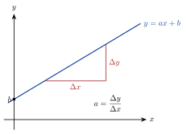

<!-- video: kommer (videoer/matte-forkurs/03-01-rette-linjer) -->
{fig-alt="Video kommer"}

<!-- tillegg: Claude -->
Den enkleste sammenhengen mellom to størrelser er en rett linje: Hver gang $x$ øker med 1, øker $y$ med det samme. Taxiprisen øker like mye for hver kilometer, og posisjonen til en bil med konstant fart øker like mye hvert sekund. Her lærer vi å lese og finne likningen for en rett linje.

## Likningen for en rett linje

::: {.graa}
$$
y = ax + b
$$
:::

::: {.kort}
- **Stigningstallet $a$** Hvor mye $y$ endrer seg når $x$ øker med 1. Positiv $a$: linja stiger. Negativ $a$: linja synker. $a = 0$: vannrett linje.
- **Konstantleddet $b$** Verdien av $y$ når $x = 0$. Det er der linja skjærer $y$-aksen.
:::

{.tikz-fig style="width:420px" fig-alt="En rett linje i et koordinatsystem. Linja skjærer y-aksen i b. En trapp under linja viser at når x øker med Δx, øker y med Δy, og stigningstallet er a = Δy/Δx."}

## Stigningstallet fra to punkter

Går linja gjennom punktene $(x_1, y_1)$ og $(x_2, y_2)$, er stigningstallet endringen i $y$ delt på endringen i $x$:

::: {.graa}
$$
a = \frac{\Delta y}{\Delta x} = \frac{y_2 - y_1}{x_2 - x_1}
$$
:::

Når vi kjenner $a$ og ett punkt $(x_1, y_1)$ på linja, gir **ettpunktsformelen** likningen:

::: {.graa}
$$
y - y_1 = a(x - x_1)
$$
:::

::: {.eksempel}
**Eksempel: Linja gjennom to punkter.** Finn likningen for linja gjennom $(1, 5)$ og $(4, -1)$.

::: {.losning}
Stigningstallet:
$$
a = \frac{-1 - 5}{4 - 1} = \frac{-6}{3} = -2
$$
Ettpunktsformelen med punktet $(1, 5)$:
$$
y - 5 = -2(x - 1) \quad\Longrightarrow\quad y = -2x + 2 + 5 \quad\Longrightarrow\quad \underline{\underline{y = -2x + 7}}
$$
Kontroll med det andre punktet: $-2\cdot 4 + 7 = -1$. Det stemmer.
:::
:::

## Parallelle og vinkelrette linjer

To linjer er **parallelle** når de har samme stigningstall. To linjer står **vinkelrett** på hverandre når produktet av stigningstallene er $-1$, altså $a_1\cdot a_2 = -1$. Linja $y = 2x$ står vinkelrett på $y = -\frac12 x + 3$.

::: {.callout-tip title="I fysikken"}
I et posisjon–tid-diagram er stigningstallet farten, og i et fart–tid-diagram er det akselerasjonen. En rett linje betyr at farten (eller akselerasjonen) er konstant. Se [strekning og hastighet](https://fysikkhjelp.no/fysikk-forkurs/kapitler/03-kinematikk/02-strekning-s-og-hastighet-v.html) og [grafer og regresjon](https://fysikkhjelp.no/fysikk-forkurs/kapitler/01-hva-er-fysikk/09-grafer-og-regresjon.html) på fysikkhjelp.no.
:::

## Prøv selv

```{.python .kjor}
import numpy as np
import matplotlib.pyplot as plt

x1, y1 = 1, 5
x2, y2 = 4, -1
a = (y2 - y1) / (x2 - x1)
b = y1 - a * x1
print(f"y = {a:g}x + {b:g}")

x = np.linspace(-1, 6, 50)
plt.plot(x, a*x + b)
plt.plot([x1, x2], [y1, y2], "o")
plt.axhline(0, color="gray"); plt.axvline(0, color="gray"); plt.grid(True); plt.show()
```

:::: {.oppgaver}

::: {.oppgave tittel="Les av linja"}
Hva er stigningstallet og konstantleddet? Stiger eller synker linja? a) $y = 3x - 2$ b) $y = 5 - \frac12 x$ c) $y = 4$

::: {.losning}
a) $a = 3$, $b = -2$, stiger. b) $a = -\frac12$, $b = 5$, synker. c) $a = 0$, $b = 4$, vannrett.
:::
:::

::: {.oppgave tittel="Linja gjennom to punkter"}
Finn likningen for linja gjennom $(-2, 1)$ og $(2, 9)$.

::: {.losning}
$a = \frac{9 - 1}{2 - (-2)} = \frac84 = 2$. Ettpunktsformelen: $y - 1 = 2(x + 2)$, så $\underline{\underline{y = 2x + 5}}$.
:::
:::

::: {.oppgave tittel="Parallell linje"}
Finn likningen for linja som er parallell med $y = -3x + 1$ og går gjennom $(2, 4)$.

::: {.losning}
Samme stigningstall, $a = -3$: $y - 4 = -3(x - 2)$, så $\underline{\underline{y = -3x + 10}}$.
:::
:::

::: {.oppgave tittel="Fjæra" niva="Middels"}
En fjær er $12.0\ \mathrm{cm}$ lang uten lodd. Med et lodd på $200\ \mathrm{g}$ er den $15.0\ \mathrm{cm}$, og med $500\ \mathrm{g}$ er den $19.5\ \mathrm{cm}$. Lengden er en lineær funksjon av massen. a) Finn stigningstallet i cm per gram, og forklar hva det betyr. b) Finn likningen $L = am + b$. c) Hvor lang er fjæra med $350\ \mathrm{g}$?

::: {.losning}
a) $a = \frac{19.5 - 15.0}{500 - 200} = \frac{4.5}{300} = 0.015\ \mathrm{cm/g}$. Fjæra blir $0.015\ \mathrm{cm}$ lengre for hvert gram, altså $1.5\ \mathrm{cm}$ per $100\ \mathrm{g}$.

b) Uten lodd er lengden $12.0\ \mathrm{cm}$, så $b = 12.0$: $\underline{\underline{L = 0.015m + 12.0}}$ (cm, med $m$ i gram). Kontroll: $0.015\cdot 200 + 12.0 = 15.0$.

c) $L = 0.015\cdot 350 + 12.0 = \underline{\underline{17.3\ \mathrm{cm}}}$
:::
:::

::: {.oppgave tittel="Vinkelrett linje" niva="Utfordrende"}
Finn likningen for linja som står vinkelrett på linja gjennom $(0, 1)$ og $(3, 7)$, og som går gjennom $(4, 0)$. Hvor skjærer de to linjene hverandre?

::: {.losning}
Den første linja: $a_1 = \frac{7 - 1}{3} = 2$, så $y = 2x + 1$. Vinkelrett: $a_2 = -\frac12$. Gjennom $(4, 0)$: $y = -\frac12(x - 4) = -\frac12 x + 2$.

Skjæring: $2x + 1 = -\frac12 x + 2$ gir $\frac52 x = 1$, så $x = 0.4$ og $y = 1.8$. Skjæringspunktet er $\underline{\underline{(0.4,\ 1.8)}}$.
:::
:::

::::
