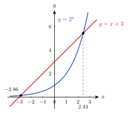

<!-- video: kommer (videoer/matte-forkurs/03-02-graftegning-og-grafisk-losning) -->
{fig-alt="Video kommer"}

<!-- tillegg: Claude -->
Mange likninger er vanskelige eller umulige å løse med algebra, for eksempel $2^x = x + 3$. Men vi kan alltid tegne grafene og se hvor de skjærer hverandre. Grafisk løsning gir oversikt, og den er en god kontroll på algebraiske svar.

## Å tegne grafer digitalt

En graf er mange punkter $(x, y)$ som tegnes og bindes sammen. Med Python lager vi en tabell med mange $x$-verdier og regner ut $y$ for alle samtidig:

```{.python .kjor}
import numpy as np
import matplotlib.pyplot as plt

x = np.linspace(-3, 3, 200)      # 200 x-verdier fra -3 til 3
y = x**2 - 2

plt.plot(x, y)
plt.axhline(0, color="gray"); plt.axvline(0, color="gray")
plt.xlabel("x"); plt.ylabel("y"); plt.grid(True); plt.show()
```

GeoGebra og grafiske kalkulatorer gjør det samme. Velg et vindu (verdier for $x$ og $y$) som viser det interessante: nullpunkter, skjæringspunkter og topp- og bunnpunkter.

## Grafisk løsning av likninger

For å løse $f(x) = g(x)$ grafisk tegner vi begge sidene som hver sin graf. Løsningene er $x$-koordinatene til **skjæringspunktene**.

::: {.steg}
1. Tegn $y = f(x)$ (venstre side) og $y = g(x)$ (høyre side) i samme koordinatsystem.
2. Finn skjæringspunktene.
3. Les av $x$-koordinatene. Det er løsningene.
:::

Vil du løse $f(x) = 0$, er løsningene **nullpunktene**, der grafen skjærer $x$-aksen.

::: {.eksempel}
**Eksempel: Likning som ikke kan løses algebraisk.** Løs $2^x = x + 3$ grafisk.

::: {.losning}
Tegn $y = 2^x$ og $y = x + 3$. Grafene skjærer hverandre i to punkter. Avlest (og kontrollert i Python under):
$$
\underline{\underline{x \approx -2.86 \quad\text{og}\quad x \approx 2.44}}
$$
Kontroll: $2^{2.44} \approx 5.43$ og $2.44 + 3 = 5.44$. Det stemmer godt.
:::
:::

<!-- tillegg: Claude -->
{.tikz-fig style="width:380px"}

## Grafisk løsning av ulikheter

Ulikheten $f(x) > g(x)$ er oppfylt der grafen til $f$ ligger **over** grafen til $g$. Les av hvilke $x$-verdier det gjelder for, med skjæringspunktene som grenser. I eksemplet over er $2^x > x + 3$ for $x < -2.86$ og for $x > 2.44$.

::: {.eksempel}
<!-- tillegg: Claude -->
**Eksempel: Ulikhet med graf.** Løs $x^2 < x + 2$ grafisk.

::: {.losning}
Tegn $y = x^2$ og $y = x + 2$. Grafene skjærer hverandre der $x^2 = x + 2$, altså i $x = -1$ og $x = 2$. Parabelen ligger **under** linja mellom skjæringspunktene:
$$
\underline{\underline{-1 < x < 2}}
$$
Endepunktene er ikke med, fordi ulikheten er streng ($<$).
:::
:::

## Prøv selv

Programmet tegner begge grafene og finner skjæringspunktene numerisk med `fsolve`. Prøv andre likninger.

```{.python .kjor}
import numpy as np
import matplotlib.pyplot as plt
from scipy.optimize import fsolve

f = lambda x: 2.0**x
g = lambda x: x + 3

x = np.linspace(-4, 4, 300)
plt.plot(x, f(x), label="2^x"); plt.plot(x, g(x), label="x + 3")
for start in (-3.0, 3.0):
    r = fsolve(lambda t: f(t) - g(t), start)[0]
    print(f"x = {r:.3f}")
    plt.plot(r, g(r), "o")
plt.legend(); plt.grid(True); plt.ylim(-2, 10); plt.show()
```

:::: {.oppgaver}

::: {.oppgave tittel="Nullpunkter"}
Tegn grafen til $f(x) = x^2 - 4x + 1$ for $x \in [-1, 5]$, og finn nullpunktene grafisk med to desimaler.

::: {.fasit}
$x \approx 0.27$ · $x \approx 3.73$
:::
:::

::: {.oppgave tittel="Skjæringspunkt"}
Løs likningen $x^2 = 2x + 3$ grafisk, og kontroller svarene ved å sette inn.

::: {.fasit}
$x = -1$ · $x = 3$
:::
:::

::: {.oppgave tittel="Ulikhet grafisk" niva="Middels"}
Bruk grafene fra forrige oppgave og løs ulikheten $x^2 < 2x + 3$.

::: {.fasit}
$-1 < x < 3$
:::
:::

::: {.oppgave tittel="Avkjøling" niva="Utfordrende"}
Temperaturen i en kopp te er $T(t) = 20 + 70\cdot 0.95^t$ (i $^\circ\mathrm{C}$, med $t$ i minutter). Når er teen avkjølt til $50\ ^\circ\mathrm{C}$? Løs grafisk eller med `fsolve`.

::: {.fasit}
$t \approx 16.5\ \mathrm{min}$
:::
:::

::::
