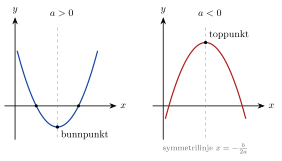

<!-- video: kommer (videoer/matte-forkurs/03-04-andregradsfunksjoner) -->
{fig-alt="Video kommer"}

<!-- tillegg: Claude -->
Kaster du en ball på skrå, følger den en bue som kalles en **parabel**. Den samme formen får du for høyden til en ball som kastes rett opp, plottet mot tiden. Parabler er grafene til andregradsfunksjoner, og de er de nest enkleste funksjonene etter rette linjer.

## Andregradsfunksjonen

::: {.graa}
$$
f(x) = ax^2 + bx + c, \qquad a \neq 0
$$
:::

{.tikz-fig style="width:520px" fig-alt="To parabler. Til venstre en parabel med a større enn null som smiler, med bunnpunkt på symmetrilinja og to nullpunkter. Til høyre en parabel med a mindre enn null som er sur, med toppunkt."}

::: {.kort}
- **Fortegnet til $a$** Er $a > 0$, vender grafen åpningen opp (den «smiler») og har et **bunnpunkt**. Er $a < 0$, vender den ned (den er «sur») og har et **toppunkt**.
- **Konstantleddet $c$** Grafen skjærer $y$-aksen i $(0, c)$.
- **Nullpunktene** Løsningene av $ax^2 + bx + c = 0$. Det kan være to, ett eller ingen.
:::

## Symmetrilinja og ekstremalpunktet

En parabel er symmetrisk om en loddrett linje gjennom topp- eller bunnpunktet:

::: {.graa}
$$
x = -\frac{b}{2a}
$$
:::

Setter vi denne $x$-verdien inn i $f$, får vi $y$-koordinaten til topp- eller bunnpunktet. Har parabelen to nullpunkter, ligger symmetrilinja midt mellom dem.

::: {.eksempel}
**Eksempel: Undersøk en parabel.** La $f(x) = x^2 - 4x + 3$. Finn skjæringen med $y$-aksen, symmetrilinja, bunnpunktet og nullpunktene.

::: {.losning}
Skjæring med $y$-aksen: $f(0) = 3$, altså $(0, 3)$.

Symmetrilinja: $x = -\frac{-4}{2\cdot 1} = 2$. Bunnpunktet: $f(2) = 4 - 8 + 3 = -1$, altså $\underline{\underline{(2, -1)}}$. Det er et bunnpunkt fordi $a = 1 > 0$.

Nullpunktene: $x^2 - 4x + 3 = (x - 1)(x - 3) = 0$, så $\underline{\underline{x = 1}}$ og $\underline{\underline{x = 3}}$. De ligger symmetrisk om $x = 2$, som de skal.
:::
:::

Hvordan vi løser andregradslikninger systematisk, lærer vi i kapitlet om faktorisering og andregradslikninger (abc-formelen).

::: {.callout-tip title="I fysikken"}
Høyden til en ball som kastes rett opp, er $y(t) = y_0 + v_0 t - \frac12\mathrm{g}t^2$. Det er en andregradsfunksjon i $t$ med $a = -\frac12\mathrm{g} < 0$, så grafen har et toppunkt: den høyeste høyden. Se [skrått kast på fysikkhjelp.no](https://fysikkhjelp.no/fysikk-forkurs/kapitler/03-kinematikk/06-bevegelse-i-to-dimensjoner.html).
:::

## Prøv selv

Endre $a$, $b$ og $c$ og se hvordan parabelen endrer seg.

```{.python .kjor}
import numpy as np
import matplotlib.pyplot as plt

a, b, c = 1, -4, 3
xs = -b / (2*a)
print(f"Symmetrilinje x = {xs:g}, ekstremalpunkt ({xs:g}, {a*xs**2 + b*xs + c:g})")

x = np.linspace(xs - 4, xs + 4, 200)
plt.plot(x, a*x**2 + b*x + c)
plt.axhline(0, color="gray"); plt.axvline(xs, color="gray", ls="--")
plt.grid(True); plt.show()
```

:::: {.oppgaver}

::: {.oppgave tittel="Smiler eller sur?"}
Har grafene toppunkt eller bunnpunkt? Hvor skjærer de $y$-aksen? a) $f(x) = 2x^2 - 3$ b) $g(x) = -x^2 + 4x$ c) $h(x) = 5 - x - x^2$

::: {.losning}
a) $a = 2 > 0$: bunnpunkt. Skjærer $y$-aksen i $(0, -3)$.

b) $a = -1 < 0$: toppunkt. Skjærer i $(0, 0)$.

c) $a = -1 < 0$: toppunkt. Skjærer i $(0, 5)$.
:::
:::

::: {.oppgave tittel="Toppunkt"}
Finn toppunktet til $g(x) = -x^2 + 4x$.

::: {.losning}
$x = -\frac{4}{2\cdot(-1)} = 2$ og $g(2) = -4 + 8 = 4$. Toppunktet er $\underline{\underline{(2, 4)}}$.
:::
:::

::: {.oppgave tittel="Høyeste punkt" niva="Middels"}
En ball kastes rett opp, og høyden er $y(t) = 1.2 + 14.7t - 4.9t^2$ (meter, sekunder). Når er ballen høyest, og hvor høyt kommer den?

::: {.losning}
Symmetrilinja: $t = -\frac{14.7}{2\cdot(-4.9)} = \underline{\underline{1.5\ \mathrm{s}}}$.

Høyden: $y(1.5) = 1.2 + 22.05 - 11.025 = \underline{\underline{12.2\ \mathrm{m}}}$
:::
:::

::: {.oppgave tittel="Største areal" niva="Utfordrende"}
Du har $40\ \mathrm{m}$ gjerde og skal lage en rektangulær innhegning. a) Vis at arealet er $A(x) = x(20 - x)$, der $x$ er den ene siden. b) Hvilken $x$ gir størst areal, og hvor stort er det?

::: {.losning}
a) Omkretsen er $2x + 2y = 40$, så den andre siden er $y = 20 - x$, og $A = xy = x(20 - x)$.

b) $A(x) = -x^2 + 20x$ har toppunkt ved $x = -\frac{20}{2\cdot(-1)} = 10$. Da er $A = 10\cdot 10 = \underline{\underline{100\ \mathrm{m^2}}}$. Det største arealet får vi med et kvadrat på $10\ \mathrm{m}\times 10\ \mathrm{m}$.
:::
:::

::::
