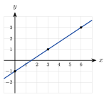

<!-- tillegg: Claude -->
Oppgavene blander rette linjer, grafisk løsning, funksjoner og parabler. Prøv selv før du åpner løsningen.

:::: {.oppgaver}

::: {.oppgave tittel="Linje fra stigningstall og punkt" krever="funksjoner/rette-linjer"}
Finn likningen for linja med stigningstall $\frac23$ som går gjennom $(3, -1)$.

::: {.fasit}
$\frac23 x - 3$
:::
:::

::: {.oppgave tittel="Linje og parabel" krever="funksjoner/grafisk-losning, algebra-og-likninger/andregradslikninger"}
Finn skjæringspunktene mellom $y = x^2 - 1$ og $y = x + 1$.

::: {.fasit}
$(2, 3)$ · $(-1, 0)$
:::
:::

::: {.oppgave tittel="Fart fra graf" niva="Middels" krever="funksjoner/rette-linjer"}
En bil er $50\ \mathrm{m}$ fra et kryss ved $t = 2.0\ \mathrm{s}$ og $170\ \mathrm{m}$ fra krysset ved $t = 8.0\ \mathrm{s}$. Posisjonen er en lineær funksjon av tiden. a) Finn farten. b) Finn posisjonen som funksjon av tiden. c) Hvor var bilen ved $t = 0$?

::: {.fasit}
a) $20\ \mathrm{m/s}$ · b) $s(t) = 20t + 10$ · c) $10\ \mathrm{m}$
:::
:::

::: {.oppgave tittel="Parabel gjennom tre punkter" niva="Middels" krever="algebra-og-likninger/likningssett, funksjoner/andregradsfunksjoner"}
En parabel $f(x) = ax^2 + bx + c$ går gjennom $(0, 2)$, $(1, 1)$ og $(2, 4)$. Finn $a$, $b$ og $c$.

::: {.fasit}
$f(x) = 2x^2 - 3x + 2$
:::
:::

::: {.oppgave tittel="Bremselengde" niva="Utfordrende" krever="funksjoner/andregradsfunksjoner"}
Bremselengden til en bil er tilnærmet $L(v) = 0.0075v^2 + 0.28v$, med $v$ i km/h og $L$ i meter. a) Finn $L(50)$ og $L(100)$. b) Hvor mange ganger lengre blir bremselengden når farten dobles fra 50 til 100 km/h? c) Hvilken fart gir en bremselengde på $60\ \mathrm{m}$? Løs grafisk.

::: {.fasit}
a) $32.8\ \mathrm{m}$ · a) $103\ \mathrm{m}$ · b) $3.1$ · c) $v \approx 73\ \mathrm{km/h}$
:::
:::

::: {.oppgave tittel="Linja fra grafen" krever="funksjoner/rette-linjer"}
<!-- tillegg: Claude -->
{.tikz-fig style="width:300px"}

Finn likningen for linja. Hvor skjærer den $x$-aksen?

::: {.fasit}
$y = \frac23x - 1$ · $x = 1.5$
:::
:::

::::
