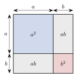

<!-- video: kommer (videoer/matte-forkurs/04-01-kvadratsetningene) -->
{fig-alt="Video kommer"}

<!-- tillegg: Claude -->
Noen produkter dukker opp så ofte at det lønner seg å kunne dem utenat. De tre **kvadratsetningene** sparer oss for mye regning, og brukt baklengs er de et av de viktigste verktøyene for å faktorisere.

## De tre setningene

::: {.graa}
$$
\begin{aligned}
(a + b)^2 &= a^2 + 2ab + b^2 &&\text{(første kvadratsetning)}\\
(a - b)^2 &= a^2 - 2ab + b^2 &&\text{(andre kvadratsetning)}\\
(a + b)(a - b) &= a^2 - b^2 &&\text{(konjugatsetningen)}
\end{aligned}
$$
:::

Alle tre følger av å gange ut parentesene. For den første: $(a + b)(a + b) = a^2 + ab + ba + b^2 = a^2 + 2ab + b^2$.

{.tikz-fig style="width:300px" fig-alt="Et kvadrat med side a pluss b, delt i fire deler: et kvadrat a i andre, et kvadrat b i andre og to rektangler ab. Det viser at (a + b) i andre er a i andre pluss 2ab pluss b i andre."}

Figuren viser første kvadratsetning som areal: Det store kvadratet med side $a + b$ består av $a^2$, $b^2$ og **to** rektangler $ab$.

::: {.callout-warning title="Den vanligste feilen"}
$(a + b)^2$ er **ikke** $a^2 + b^2$. Det midterste leddet $2ab$ glemmes ofte. Kontroller med tall: $(3 + 2)^2 = 25$, mens $3^2 + 2^2 = 13$. Forskjellen er $2\cdot 3\cdot 2 = 12$.
:::

::: {.eksempel}
**Eksempel: Gang ut med kvadratsetningene.** Skriv uten parenteser: a) $(2x + 3)^2$ b) $(x - 5)^2$ c) $(3x + 4)(3x - 4)$

::: {.losning}
a) $a = 2x$, $b = 3$: $(2x)^2 + 2\cdot 2x\cdot 3 + 3^2 = \underline{\underline{4x^2 + 12x + 9}}$

b) $a = x$, $b = 5$: $\underline{\underline{x^2 - 10x + 25}}$

c) Konjugatsetningen: $(3x)^2 - 4^2 = \underline{\underline{9x^2 - 16}}$
:::
:::

## Baklengs: å kjenne igjen et kvadrat

Ser du tre ledd der to er kvadrater og det tredje er det dobbelte produktet, kan du skrive uttrykket som et kvadrat:
$$
x^2 + 6x + 9 = x^2 + 2\cdot x\cdot 3 + 3^2 = (x + 3)^2
$$
Og en differanse av to kvadrater kan alltid faktoriseres med konjugatsetningen:
$$
x^2 - 49 = (x + 7)(x - 7)
$$

## Hoderegning

Kvadratsetningene gjør noen utregninger enkle i hodet: $51^2 = (50 + 1)^2 = 2500 + 100 + 1 = 2601$, og $29\cdot 31 = (30 - 1)(30 + 1) = 900 - 1 = 899$.

## Prøv selv

```{.python .kjor}
from sympy import symbols, expand, factor
x = symbols("x")
print(expand((2*x + 3)**2))     # 4*x**2 + 12*x + 9
print(factor(x**2 + 6*x + 9))   # (x + 3)**2
print(factor(x**2 - 49))        # (x - 7)*(x + 7)
```

:::: {.oppgaver}

::: {.oppgave tittel="Gang ut"}
Bruk kvadratsetningene: a) $(x + 4)^2$ b) $(3 - 2y)^2$ c) $(a + 6)(a - 6)$ d) $\left(x + \frac12\right)^2$

::: {.losning}
a) $\underline{\underline{x^2 + 8x + 16}}$ b) $\underline{\underline{9 - 12y + 4y^2}}$ c) $\underline{\underline{a^2 - 36}}$ d) $\underline{\underline{x^2 + x + \frac14}}$
:::
:::

::: {.oppgave tittel="Skriv som kvadrat"}
Skriv som kvadrat eller produkt: a) $x^2 - 8x + 16$ b) $4x^2 + 4x + 1$ c) $25 - x^2$

::: {.losning}
a) $\underline{\underline{(x - 4)^2}}$ b) $\underline{\underline{(2x + 1)^2}}$ c) $\underline{\underline{(5 + x)(5 - x)}}$
:::
:::

::: {.oppgave tittel="Hoderegning"}
Regn ut i hodet: a) $41^2$ b) $98^2$ c) $47\cdot 53$

::: {.losning}
a) $(40 + 1)^2 = 1600 + 80 + 1 = \underline{\underline{1681}}$

b) $(100 - 2)^2 = 10000 - 400 + 4 = \underline{\underline{9604}}$

c) $(50 - 3)(50 + 3) = 2500 - 9 = \underline{\underline{2491}}$
:::
:::

::: {.oppgave tittel="Forenkle" niva="Middels"}
Forenkle $(x + 3)^2 - (x - 3)^2$.

::: {.losning}
$(x^2 + 6x + 9) - (x^2 - 6x + 9) = \underline{\underline{12x}}$. (Eller med konjugatsetningen: $\big((x + 3) + (x - 3)\big)\big((x + 3) - (x - 3)\big) = 2x\cdot 6 = 12x$.)
:::
:::

::: {.oppgave tittel="Fullstendig kvadrat" niva="Utfordrende"}
Hvilket tall må stå i stedet for $c$ for at $x^2 + 10x + c$ skal være et fullstendig kvadrat? Skriv deretter $x^2 + 10x + 30$ på formen $(x + p)^2 + q$.

::: {.losning}
$2\cdot x\cdot 5 = 10x$, så $c = 5^2 = \underline{\underline{25}}$, og $x^2 + 10x + 25 = (x + 5)^2$.

Da er $x^2 + 10x + 30 = (x + 5)^2 + 5$. Denne formen viser direkte at uttrykket aldri blir mindre enn $5$.
:::
:::

::::
