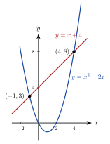

<!-- video: kommer (videoer/matte-forkurs/04-05-ikke-lineare-likningssett) -->
{fig-alt="Video kommer"}

<!-- tillegg: Claude -->
Et likningssett er **ikke-lineært** når minst én av likningene har $x^2$, $xy$ eller lignende. Grafisk handler det ofte om hvor en linje skjærer en parabel eller en sirkel. Innsettingsmetoden virker fortsatt, men vi ender gjerne med en andregradslikning, og da kan det bli null, én eller to løsninger.

## Innsetting gir en andregradslikning

::: {.steg}
1. Løs den lineære likningen med hensyn på én ukjent.
2. Sett inn i den ikke-lineære likningen.
3. Løs andregradslikningen.
4. Finn den andre ukjente for **hver** løsning.
:::

::: {.eksempel}
**Eksempel: Linje og parabel.** Løs likningssettet
$$
\begin{aligned} y &= x^2 - 2x \\ y &= x + 4 \end{aligned}
$$

::: {.losning}
Sett høyresidene like: $x^2 - 2x = x + 4$, så $x^2 - 3x - 4 = 0$ og $(x - 4)(x + 1) = 0$. Det gir $x = 4$ eller $x = -1$.

For $x = 4$: $y = 8$. For $x = -1$: $y = 3$. Løsningene er $\underline{\underline{(4, 8) \text{ og } (-1, 3)}}$.

Grafisk er dette de to punktene der linja skjærer parabelen.
:::
:::

::: {.eksempel}
**Eksempel: Produkt og sum.** To tall har summen $10$ og produktet $21$. Hvilke tall er det?

::: {.losning}
$x + y = 10$ og $xy = 21$. Fra den første: $y = 10 - x$. Sett inn: $x(10 - x) = 21$, så $x^2 - 10x + 21 = 0$ og $(x - 3)(x - 7) = 0$.

Tallene er $\underline{\underline{3 \text{ og } 7}}$.
:::
:::

<!-- tillegg: Claude -->
{.tikz-fig style="width:340px"}

## Hvor mange løsninger?

En linje kan skjære en parabel i to punkter, berøre den i ett punkt (da er linja en **tangent**), eller ikke treffe den i det hele tatt. Diskriminanten i andregradslikningen forteller hvilket tilfelle vi har.

:::: {.oppgaver}

::: {.oppgave tittel="Linje og parabel"}
Løs likningssettet $y = x^2$ og $y = 2x + 3$.

::: {.fasit}
$(3, 9) \text{ og } (-1, 1)$
:::
:::

::: {.oppgave tittel="Tangent?" niva="Middels"}
Vis at linja $y = 2x - 1$ bare har ett punkt felles med parabelen $y = x^2$. Hva kaller vi en slik linje?

:::

::: {.oppgave tittel="Rektangel" niva="Middels"}
Et rektangel har omkrets $26\ \mathrm{cm}$ og areal $40\ \mathrm{cm^2}$. Finn sidene.

::: {.fasit}
$5\ \mathrm{cm} \text{ og } 8\ \mathrm{cm}$
:::
:::

::: {.oppgave tittel="Linje og sirkel" niva="Utfordrende"}
Sirkelen $x^2 + y^2 = 25$ har sentrum i origo og radius 5. Finn skjæringspunktene med linja $y = x + 1$.

::: {.fasit}
$(3, 4) \text{ og } (-4, -3)$
:::
:::

::::
