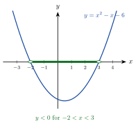

<!-- video: kommer (videoer/matte-forkurs/04-06-andregradsulikheter) -->
{fig-alt="Video kommer"}

<!-- tillegg: Claude -->
Når vi kjenner nullpunktene til et andregradsuttrykk, kan vi alltid faktorisere det, også når heltallsmetoden ikke virker. Det faktoriserte uttrykket gjør det enkelt å finne hvor uttrykket er positivt og negativt, og dermed å løse andregradsulikheter.

## Nullpunktsfaktorisering

::: {.graa}
Har $ax^2 + bx + c = 0$ løsningene $x_1$ og $x_2$, er
$$
ax^2 + bx + c = a(x - x_1)(x - x_2)
$$
:::

Husk faktoren $a$ foran. Uten den blir koeffisienten foran $x^2$ feil.

::: {.eksempel}
**Eksempel: Nullpunktsfaktorisering.** Faktoriser $2x^2 - x - 3$.

::: {.losning}
abc-formelen: $x = \frac{1 \pm\sqrt{1 + 24}}{4} = \frac{1 \pm 5}{4}$, så $x_1 = \frac32$ og $x_2 = -1$.
$$
2x^2 - x - 3 = \underline{\underline{2\left(x - \tfrac32\right)(x + 1) = (2x - 3)(x + 1)}}
$$
:::
:::

## Fortegnslinjer

Et produkt er positivt når det er et partall antall negative faktorer. Vi tegner en fortegnslinje for hver faktor og «multipliserer» fortegnene.

::: {.eksempel}
**Eksempel: Andregradsulikhet.** Løs $x^2 - x - 6 < 0$.

::: {.losning}
Faktoriser: $x^2 - x - 6 = (x + 2)(x - 3)$. Fortegnslinjer:

```{=html}
<div class="graa" style="font-family: monospace; padding: .6rem 1rem; white-space: pre;">x:              −2           3
x + 2:   − − − −  0  + + + + + + + + +
x − 3:   − − − − − − − − − −  0  + + +
produkt: + + + +  0  − − − −  0  + + +</div>
```

Uttrykket er negativt mellom nullpunktene: $\underline{\underline{-2 < x < 3}}$, altså $x \in \langle -2, 3\rangle$.
:::
:::

::: {.callout-tip title="Snarvei med grafen"}
For $a > 0$ smiler parabelen, så uttrykket er negativt **mellom** nullpunktene og positivt utenfor. For $a < 0$ er det omvendt. Tenk på grafen, så slipper du å tegne fortegnslinjer for enkle tilfeller.
:::

::: {.callout-warning title="Ikke gang med x"}
I ulikheter kan vi ikke gange eller dele med uttrykk som inneholder $x$, fordi vi ikke vet om de er positive eller negative. Flytt heller alt over på én side og faktoriser.
:::

<!-- tillegg: Claude -->
{.tikz-fig style="width:400px"}

:::: {.oppgaver}

::: {.oppgave tittel="Nullpunktsfaktoriser"}
Faktoriser ved å finne nullpunktene: a) $x^2 - 2x - 2$ b) $3x^2 + 5x - 2$

::: {.fasit}
a) $\left(x - 1 - \sqrt3\right)\left(x - 1 + \sqrt3\right)$ · b) $(3x - 1)(x + 2)$
:::
:::

::: {.oppgave tittel="Løs ulikhetene"}
a) $x^2 - 4 > 0$ b) $x^2 + 2x - 15 \le 0$ c) $-x^2 + 4x \ge 0$

::: {.fasit}
a) $x < -2 \text{ eller } x > 2$ · b) $-5 \le x \le 3$ · c) $0 \le x \le 4$
:::
:::

::: {.oppgave tittel="Ingen nullpunkter" niva="Middels"}
Løs ulikhetene: a) $x^2 + x + 1 > 0$ b) $x^2 + x + 1 < 0$

::: {.fasit}
$\text{alle } x$ · $\text{ingen løsning}$
:::
:::

::: {.oppgave tittel="Ballen over 5 meter" niva="Utfordrende"}
Høyden til en ball er $y(t) = 1.0 + 12t - 4.9t^2$ (meter, sekunder). I hvilket tidsrom er ballen høyere enn $5.0\ \mathrm{m}$?

::: {.fasit}
$0.40\ \mathrm{s} < t < 2.0\ \mathrm{s}$
:::
:::

::::
