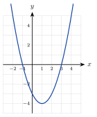

<!-- tillegg: Claude -->
Oppgavene blander kvadratsetninger, faktorisering, andregradslikninger og -ulikheter. Prøv selv før du åpner løsningen.

:::: {.oppgaver}

::: {.oppgave tittel="Faktoriser" krever="algebra-og-likninger/faktorisering"}
Faktoriser fullstendig: a) $4x^2 - 25$ b) $x^3 - 6x^2 + 9x$ c) $2x^2 + 2x - 24$

::: {.fasit}
$(2x + 5)(2x - 5)$ · $x(x - 3)^2$ · $2(x + 4)(x - 3)$
:::
:::

::: {.oppgave tittel="Andregradslikninger" krever="algebra-og-likninger/andregradslikninger"}
Løs: a) $x^2 = 5x$ b) $2x^2 + 3x - 2 = 0$ c) $x^2 + 6x + 10 = 0$

::: {.fasit}
a) $x = 0 \text{ eller } x = 5$ · b) $x = \frac12 \text{ eller } x = -2$ · c) $\text{ingen løsning}$
:::
:::

::: {.oppgave tittel="Forkort" niva="Middels" krever="algebra-og-likninger/faktorisering, algebra-og-likninger/rasjonale-uttrykk"}
Forkort $\dfrac{2x^2 - 8}{x^2 + 4x + 4}$.

::: {.fasit}
$\frac{2(x - 2)}{x + 2}$
:::
:::

::: {.oppgave tittel="Ulikhet" niva="Middels" krever="algebra-og-likninger/ulikheter, algebra-og-likninger/andregradslikninger"}
Løs ulikheten $x^2 \ge 3x + 10$.

::: {.fasit}
$x \le -2 \text{ eller } x \ge 5$
:::
:::

::: {.oppgave tittel="Steinen i brønnen" niva="Utfordrende" krever="algebra-og-likninger/andregradslikninger, algebra-og-likninger/likninger"}
En stein slippes ned i en brønn. Etter $t$ sekunder har den falt $4.9t^2$ meter. Lyden av plasket går opp med $340\ \mathrm{m/s}$. Du hører plasket $2.50\ \mathrm{s}$ etter at du slapp steinen. Hvor dyp er brønnen?

::: {.fasit}
$28.6\ \mathrm{m}$
:::
:::

::: {.oppgave tittel="Finn uttrykket" krever="algebra-og-likninger/andregradslikninger, algebra-og-likninger/faktorisering"}
<!-- tillegg: Claude -->
{.tikz-fig style="width:260px"}

Parabelen har formen $f(x) = x^2 + bx + c$. Les av nullpunktene, og skriv $f(x)$ på faktorisert form og på vanlig form. Kontroller med skjæringen med $y$-aksen.

::: {.fasit}
$(x + 1)(x - 3)$ · $x^2 - 2x - 3$
:::
:::

::::
