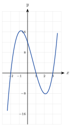

<!-- tillegg: Claude -->
Oppgavene blander polynomdivisjon, faktorisering og rasjonale og irrasjonale likninger. Prøv selv før du åpner løsningen.

:::: {.oppgaver}

::: {.oppgave tittel="Polynomdivisjon" krever="algebra-og-likninger/polynomer"}
Regn ut $(x^3 - 8) : (x - 2)$.

::: {.fasit}
$x^2 + 2x + 4$
:::
:::

::: {.oppgave tittel="Faktoriser og løs" krever="algebra-og-likninger/polynomer"}
Løs $x^3 - 6x^2 + 11x - 6 = 0$.

::: {.fasit}
$x = 1, 2, 3$
:::
:::

::: {.oppgave tittel="Rasjonal likning" niva="Middels" krever="algebra-og-likninger/rasjonale-uttrykk, algebra-og-likninger/likninger"}
Løs $\dfrac{x}{x + 1} + \dfrac{2}{x - 1} = 1$.

::: {.fasit}
$x = -3$
:::
:::

::: {.oppgave tittel="Rasjonal ulikhet" niva="Middels" krever="algebra-og-likninger/ulikheter, algebra-og-likninger/rasjonale-uttrykk"}
Løs $\dfrac{x^2 - 4}{x} \ge 0$.

::: {.fasit}
$-2 \le x < 0 \text{ eller } x \ge 2$
:::
:::

::: {.oppgave tittel="Irrasjonal likning" niva="Utfordrende" krever="algebra-og-likninger/likninger, tall-og-regneregler/rotter"}
Løs $x - \sqrt{x} - 6 = 0$. (Hint: sett $u = \sqrt x$.)

::: {.fasit}
$x = 9$
:::
:::

::: {.oppgave tittel="Polynom fra graf" niva="Middels" krever="algebra-og-likninger/polynomer"}
<!-- tillegg: Claude -->
{.tikz-fig style="width:280px"}

Grafen viser et tredjegradspolynom. Les av nullpunktene og $P(0)$, og finn $P(x)$.

::: {.fasit}
$2(x + 2)(x - 1)(x - 3)$
:::
:::

::::
