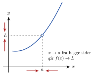

<!-- video: kommer (videoer/matte-forkurs/06-01-grenseverdier) -->
{fig-alt="Video kommer"}

<!-- tillegg: Claude -->
Hva er $\dfrac{x^2 - 1}{x - 1}$ når $x = 1$? Setter vi inn, får vi $\frac00$, som ikke er definert. Men vi kan spørre hva uttrykket **nærmer seg** når $x$ kommer nærmere og nærmere 1. Svaret kalles en **grenseverdi**, og den er selve grunnmuren for derivasjon.

## Hva en grenseverdi er

::: {.callout-note title="Definisjon: Grenseverdi"}
$\displaystyle\lim_{x\to a} f(x) = L$ betyr at $f(x)$ kommer så nær $L$ vi vil, bare $x$ er nær nok $a$ (men $x \ne a$).
:::

Funksjonen trenger ikke være definert i $x = a$. Det er oppførselen **rundt** $a$ som teller.

::: {.eksempel}
**Eksempel: Tallene viser vei.** Finn $\displaystyle\lim_{x\to 1}\frac{x^2 - 1}{x - 1}$.

::: {.losning}
En tabell med $x$ nær 1:

| $x$ | $0.9$ | $0.99$ | $0.999$ | $1.001$ | $1.01$ | $1.1$ |
|:---:|:---:|:---:|:---:|:---:|:---:|:---:|
| $f(x)$ | $1.9$ | $1.99$ | $1.999$ | $2.001$ | $2.01$ | $2.1$ |

Verdiene nærmer seg 2. Algebraisk: faktoriser og forkort (lov fordi $x \ne 1$):
$$
\frac{(x + 1)(x - 1)}{x - 1} = x + 1 \longrightarrow 2 \quad\text{når } x\to 1
$$
Svaret er $\underline{\underline{2}}$.
:::
:::

<!-- tillegg: Claude -->
{.tikz-fig style="width:400px"}

## Regneregler

Grenseverdier av summer, produkter og brøker kan regnes ledd for ledd, så lenge grensene finnes og vi ikke deler på null. For polynomer og andre «pene» funksjoner kan vi derfor bare sette inn: $\displaystyle\lim_{x\to 2}(x^2 + 3x) = 4 + 6 = 10$.

::: {.steg}
1. Prøv å sette inn $x = a$. Får du et tall, er det grenseverdien.
2. Får du $\frac00$, faktoriser og forkort (eller utvid med konjugatet ved røtter), og prøv igjen.
3. Får du $\frac{\text{tall}}{0}$, går funksjonen mot $\pm\infty$, og grenseverdien finnes ikke.
:::

## Ensidige grenseverdier

Noen ganger nærmer funksjonen seg forskjellige verdier fra venstre og høyre. Vi skriver $\lim\limits_{x\to a^-}$ (fra venstre) og $\lim\limits_{x\to a^+}$ (fra høyre). Grenseverdien finnes bare hvis de to er like.

## Grenseverdier når x går mot uendelig

$\displaystyle\lim_{x\to\infty} f(x)$ forteller hva som skjer langt ute. For brøker av polynomer deler vi teller og nevner på den høyeste potensen i nevneren:
$$
\lim_{x\to\infty}\frac{3x^2 + 1}{x^2 - 5} = \lim_{x\to\infty}\frac{3 + \frac{1}{x^2}}{1 - \frac{5}{x^2}} = \frac{3 + 0}{1 - 0} = 3
$$

::: {.eksempel}
<!-- tillegg: Claude -->
**Eksempel: Når x går mot uendelig.** Finn $\displaystyle\lim_{x\to\infty}\frac{3x^2 - x}{2x^2 + 5}$.

::: {.losning}
Del teller og nevner på den høyeste potensen, $x^2$:
$$
\lim_{x\to\infty}\frac{3 - \frac1x}{2 + \frac{5}{x^2}} = \frac{3 - 0}{2 + 0} = \underline{\underline{\frac32}}
$$
For store $x$ er det bare leddene med høyest grad som betyr noe.
:::
:::

## Prøv selv

```{.python .kjor}
f = lambda x: (x**2 - 1) / (x - 1)
for h in [0.1, 0.01, 0.001, 1e-6]:
    print(1 - h, f(1 - h), "   ", 1 + h, f(1 + h))
```

:::: {.oppgaver}

::: {.oppgave tittel="Sett inn"}
Finn: a) $\displaystyle\lim_{x\to 3}(2x^2 - x)$ b) $\displaystyle\lim_{x\to 0}\frac{x + 4}{x - 2}$

::: {.fasit}
$15$ · $-2$
:::
:::

::: {.oppgave tittel="0/0"}
Finn: a) $\displaystyle\lim_{x\to 2}\frac{x^2 - 4}{x - 2}$ b) $\displaystyle\lim_{x\to -3}\frac{x^2 + x - 6}{x + 3}$

::: {.fasit}
$4$ · $-5$
:::
:::

::: {.oppgave tittel="Mot uendelig" niva="Middels"}
Finn: a) $\displaystyle\lim_{x\to\infty}\frac{2x + 1}{5x - 3}$ b) $\displaystyle\lim_{x\to\infty}\frac{x}{x^2 + 1}$

::: {.fasit}
a) $\frac25$ · b) $0$
:::
:::

::: {.oppgave tittel="Med rot" niva="Utfordrende"}
Finn $\displaystyle\lim_{x\to 0}\frac{\sqrt{x + 4} - 2}{x}$. (Hint: utvid med $\sqrt{x + 4} + 2$.)

::: {.fasit}
$\frac14$
:::
:::

::::
