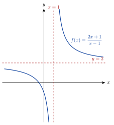

<!-- video: kommer (videoer/matte-forkurs/06-03-asymptoter) -->
{fig-alt="Video kommer"}

<!-- tillegg: Claude -->
En **asymptote** er en rett linje som grafen nærmer seg mer og mer uten å nå den. Asymptoter viser hvordan grafen oppfører seg nær forbudte $x$-verdier og langt ute til sidene.

{.tikz-fig style="width:420px" fig-alt="Grafen til en brøkfunksjon med en loddrett asymptote x = 1 og en vannrett asymptote y = 2. Grafen har to grener som nærmer seg asymptotene."}

## Tre typer

::: {.kort}
- **Vertikal (loddrett) asymptote $x = a$** Funksjonen går mot $\pm\infty$ når $x\to a$. For brøker skjer det der nevneren er null og telleren ikke er null.
- **Horisontal (vannrett) asymptote $y = b$** $f(x)\to b$ når $x\to\pm\infty$. For brøker av polynomer finnes den når graden i telleren er mindre enn eller lik graden i nevneren.
- **Skrå asymptote $y = ax + b$** Finnes når graden i telleren er nøyaktig én større enn i nevneren. Vi finner den med polynomdivisjon.
:::

::: {.eksempel}
**Eksempel: Vertikal og horisontal.** Finn asymptotene til $f(x) = \dfrac{2x + 1}{x - 1}$.

::: {.losning}
Nevneren er null for $x = 1$, og telleren er da $3 \ne 0$. Vertikal asymptote: $\underline{\underline{x = 1}}$.

Langt ute: $\dfrac{2x + 1}{x - 1} = \dfrac{2 + 1/x}{1 - 1/x}\to 2$. Horisontal asymptote: $\underline{\underline{y = 2}}$.
:::
:::

::: {.eksempel}
**Eksempel: Skrå asymptote.** Finn asymptotene til $g(x) = \dfrac{x^2 + 1}{x - 1}$.

::: {.losning}
Vertikal: $\underline{\underline{x = 1}}$.

Polynomdivisjon: $(x^2 + 1) : (x - 1) = x + 1$ med rest $2$, så
$$
g(x) = x + 1 + \frac{2}{x - 1}
$$
Brøken går mot null langt ute, så grafen nærmer seg linja $\underline{\underline{y = x + 1}}$. Det er den skrå asymptoten.
:::
:::

::: {.callout-warning title="Når telleren også er null"}
$\dfrac{x^2 - 1}{x - 1}$ har **ikke** en vertikal asymptote i $x = 1$, fordi telleren også er null der. Etter forkorting er funksjonen $x + 1$, og grafen har bare et hull.
:::

:::: {.oppgaver}

::: {.oppgave tittel="Finn asymptotene"}
a) $f(x) = \dfrac{3}{x + 2}$ b) $g(x) = \dfrac{4x - 1}{2x + 6}$

::: {.losning}
a) Vertikal $\underline{\underline{x = -2}}$, horisontal $\underline{\underline{y = 0}}$.

b) Vertikal $\underline{\underline{x = -3}}$, horisontal $\underline{\underline{y = 2}}$ (forholdet mellom koeffisientene $\frac42$).
:::
:::

::: {.oppgave tittel="Skrå asymptote" niva="Middels"}
Finn alle asymptotene til $h(x) = \dfrac{x^2 - 3x}{x + 1}$.

::: {.losning}
Vertikal $\underline{\underline{x = -1}}$. Divisjon: $(x^2 - 3x) : (x + 1) = x - 4$ med rest $4$. Skrå asymptote $\underline{\underline{y = x - 4}}$.
:::
:::

::: {.oppgave tittel="Hull eller asymptote?" niva="Utfordrende"}
Undersøk $f(x) = \dfrac{x^2 - 4}{x^2 - x - 2}$ nær $x = 2$ og $x = -1$, og finn den horisontale asymptoten.

::: {.losning}
$f(x) = \frac{(x + 2)(x - 2)}{(x - 2)(x + 1)} = \frac{x + 2}{x + 1}$ for $x \ne 2$.

I $x = 2$ er det et **hull** (grenseverdien er $\frac43$). I $x = -1$ er det en **vertikal asymptote**. Horisontal asymptote $\underline{\underline{y = 1}}$.
:::
:::

::::
