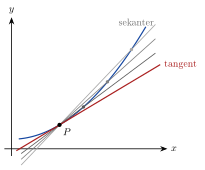

<!-- video: kommer (videoer/matte-forkurs/06-04-vekstfart) -->
{fig-alt="Video kommer"}

<!-- tillegg: Claude -->
Hvor fort vokser noe? Kjører du 120 km på 2 timer, er gjennomsnittsfarten 60 km/h. Men speedometeret viser farten **akkurat nå**, og den kan være 80 km/h i ett øyeblikk og 30 km/h i det neste. Derivasjon er matematikken for denne «farten akkurat nå», for alle slags funksjoner.

## Gjennomsnittlig vekstfart

::: {.graa}
Den gjennomsnittlige vekstfarten til $f$ fra $x = a$ til $x = b$ er
$$
\frac{\Delta f}{\Delta x} = \frac{f(b) - f(a)}{b - a}
$$
:::

Grafisk er det stigningstallet til **sekanten**, linja gjennom $(a, f(a))$ og $(b, f(b))$.

## Momentan vekstfart

Lar vi $b$ komme nærmere og nærmere $a$, blir sekanten til en **tangent**, og stigningstallet blir den momentane vekstfarten. Den kalles den **deriverte** av $f$ i $a$:

{.tikz-fig style="width:440px" fig-alt="En krum graf med et punkt P. Flere sekanter går gjennom P og punkter som kommer nærmere P, og de nærmer seg tangenten i P."}

::: {.callout-note title="Definisjon: Den deriverte"}
$$
f'(a) = \lim_{h\to 0}\frac{f(a + h) - f(a)}{h}
$$
:::

$f'(a)$ er stigningstallet til tangenten i punktet $(a, f(a))$, og den momentane vekstfarten til $f$ i $x = a$.

::: {.eksempel}
**Eksempel: Derivert fra definisjonen.** Finn $f'(3)$ når $f(x) = x^2$.

::: {.losning}
$$
\frac{f(3 + h) - f(3)}{h} = \frac{9 + 6h + h^2 - 9}{h} = \frac{6h + h^2}{h} = 6 + h
$$
Når $h\to 0$, går dette mot $6$. Så $\underline{\underline{f'(3) = 6}}$: Tangenten i $(3, 9)$ har stigningstallet 6.
:::
:::

Gjør vi det samme for en vilkårlig $x$, får vi $\dfrac{(x + h)^2 - x^2}{h} = 2x + h \to 2x$. Altså er $f'(x) = 2x$ for $f(x) = x^2$. Den deriverte er selv en funksjon.

::: {.callout-tip title="I fysikken"}
Farten er den deriverte av posisjonen, og akselerasjonen er den deriverte av farten. Se [strekning og hastighet](https://fysikkhjelp.no/fysikk-forkurs/kapitler/03-kinematikk/02-strekning-s-og-hastighet-v.html) og [akselerasjon](https://fysikkhjelp.no/fysikk-forkurs/kapitler/03-kinematikk/03-akselerasjon.html) på fysikkhjelp.no.
:::

## Prøv selv

Programmet regner ut stigningstallet til sekanten for mindre og mindre $h$. Se at det nærmer seg $f'(3) = 6$.

```{.python .kjor}
f = lambda x: x**2
a = 3
for h in [1, 0.1, 0.01, 0.001, 1e-6]:
    print(f"h = {h:<8} sekant: {(f(a + h) - f(a)) / h:.6f}")
```

:::: {.oppgaver}

::: {.oppgave tittel="Gjennomsnittlig vekstfart"}
Finn den gjennomsnittlige vekstfarten til $f(x) = x^2 - 2x$ fra $x = 1$ til $x = 4$.

::: {.losning}
$f(1) = -1$, $f(4) = 8$: $\frac{8 - (-1)}{4 - 1} = \underline{\underline{3}}$.
:::
:::

::: {.oppgave tittel="Fra definisjonen" niva="Middels"}
Bruk definisjonen og finn $f'(x)$ når $f(x) = 3x^2 + 1$.

::: {.losning}
$$
\frac{3(x + h)^2 + 1 - 3x^2 - 1}{h} = \frac{6xh + 3h^2}{h} = 6x + 3h \to \underline{\underline{6x}}
$$
:::
:::

::: {.oppgave tittel="Snittfart og momentan fart" niva="Middels"}
En stein faller, og strekningen er $s(t) = 4.9t^2$ (meter, sekunder). a) Finn gjennomsnittsfarten de første $2.0\ \mathrm{s}$. b) Finn farten ved $t = 2.0\ \mathrm{s}$ med definisjonen.

::: {.losning}
a) $\frac{s(2) - s(0)}{2} = \frac{19.6}{2} = \underline{\underline{9.8\ \mathrm{m/s}}}$

b) $\frac{4.9(2 + h)^2 - 4.9\cdot 4}{h} = \frac{19.6h + 4.9h^2}{h} = 19.6 + 4.9h \to \underline{\underline{19.6\ \mathrm{m/s}}}$. Momentanfarten ved 2 s er det dobbelte av gjennomsnittsfarten, slik den skal være ved konstant akselerasjon fra ro.
:::
:::

::: {.oppgave tittel="Derivert av 1/x" niva="Utfordrende"}
Vis med definisjonen at $f'(x) = -\dfrac{1}{x^2}$ når $f(x) = \dfrac1x$.

::: {.losning}
$$
\frac{\frac{1}{x + h} - \frac1x}{h} = \frac{x - (x + h)}{h\,x(x + h)} = \frac{-1}{x(x + h)} \to -\frac{1}{x^2}
$$
:::
:::

::::
