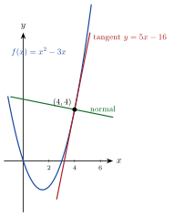

<!-- video: kommer (videoer/matte-forkurs/06-05-tangenter-og-normaler) -->
{fig-alt="Video kommer"}

<!-- tillegg: Claude -->
Tangenten er den rette linja som best ligner grafen rundt et punkt. Zoomer du nok inn på en glatt graf, ser den ut som tangenten. Normalen er linja som står vinkelrett på tangenten i det samme punktet.

## Likningen for tangenten

Tangenten i punktet $(a, f(a))$ har stigningstallet $f'(a)$. Ettpunktsformelen gir:

::: {.graa}
$$
y - f(a) = f'(a)(x - a)
$$
:::

::: {.eksempel}
**Eksempel: Tangent.** Finn likningen for tangenten til $f(x) = x^2 - 3x$ i punktet der $x = 4$. Bruk at $f'(x) = 2x - 3$.

::: {.losning}
Punktet: $f(4) = 16 - 12 = 4$, altså $(4, 4)$. Stigningstallet: $f'(4) = 8 - 3 = 5$.
$$
y - 4 = 5(x - 4) \quad\Longrightarrow\quad \underline{\underline{y = 5x - 16}}
$$
:::
:::

## Normalen

Normalen står vinkelrett på tangenten. To linjer er vinkelrette når produktet av stigningstallene er $-1$, så normalen har stigningstallet $-\dfrac{1}{f'(a)}$ (når $f'(a) \ne 0$):

::: {.graa}
$$
y - f(a) = -\frac{1}{f'(a)}(x - a)
$$
:::

I eksemplet over har normalen stigningstallet $-\frac15$: $y - 4 = -\frac15(x - 4)$, altså $y = -\frac15 x + \frac{24}{5}$.

<!-- tillegg: Claude -->
{.tikz-fig style="width:380px"}

## Vannrett tangent

Der $f'(a) = 0$, er tangenten vannrett. Det skjer i topp- og bunnpunkter, og det skal vi bruke mye i funksjonsdrøftingen.

::: {.callout-tip title="Tangenten som tilnærming"}
Nær $x = a$ er $f(x) \approx f(a) + f'(a)(x - a)$. I fysikk bruker vi denne lineære tilnærmingen hele tiden, for eksempel $\sin\theta \approx \theta$ for små vinkler i pendelen.
:::

::: {.eksempel}
<!-- tillegg: Claude -->
**Eksempel: Hvor er tangenten vannrett?** Finn punktene på grafen til $f(x) = x^3 - 3x$ der tangenten er vannrett.

::: {.losning}
Vannrett tangent betyr stigningstall null: $f'(x) = 3x^2 - 3 = 0$, så $x^2 = 1$ og $x = \pm1$.
$$
f(-1) = -1 + 3 = 2, \qquad f(1) = 1 - 3 = -2
$$
Punktene er $\underline{\underline{(-1, 2)}}$ og $\underline{\underline{(1, -2)}}$. Det er toppunktet og bunnpunktet på grafen.
:::
:::

:::: {.oppgaver}

::: {.oppgave tittel="Tangent"}
Finn tangenten til $f(x) = x^2$ i $x = -1$. ($f'(x) = 2x$.)

::: {.fasit}
$y = -2x - 1$
:::
:::

::: {.oppgave tittel="Normal" niva="Middels"}
Finn normalen til $f(x) = x^2$ i $x = 1$.

::: {.fasit}
$y = -\frac12 x + \frac32$
:::
:::

::: {.oppgave tittel="Tangent med gitt stigning" niva="Utfordrende"}
I hvilket punkt har $f(x) = x^2 - 4x + 1$ en tangent som er parallell med $y = 2x$? Finn tangentlikningen. ($f'(x) = 2x - 4$.)

::: {.fasit}
$y = 2x - 8$
:::
:::

::::
