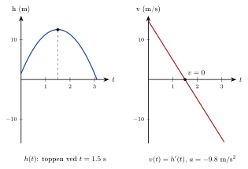

<!-- video: kommer (videoer/matte-forkurs/06-07-fart-og-akselerasjon) -->
{fig-alt="Video kommer"}

<!-- tillegg: Claude -->
Derivasjon ble oppfunnet for å beskrive bevegelse. Kjenner vi posisjonen som funksjon av tiden, gir den deriverte farten, og den deriverte av farten gir akselerasjonen. Her ser vi hvordan matematikken og fysikken henger sammen.

## Posisjon, fart og akselerasjon

::: {.graa}
$$
v(t) = s'(t) \qquad\qquad a(t) = v'(t) = s''(t)
$$
:::

::: {.kort}
- **Posisjon $s(t)$** Hvor gjenstanden er ved tiden $t$.
- **Fart $v(t)$** Hvor fort posisjonen endrer seg. Stigningstallet til $s$-grafen. Negativ fart betyr bevegelse i negativ retning.
- **Akselerasjon $a(t)$** Hvor fort farten endrer seg. Stigningstallet til $v$-grafen.
:::

$s''$ kalles den **andrederiverte**: Vi deriverer to ganger.

::: {.eksempel}
**Eksempel: Konstant akselerasjon.** En bil har posisjonen $s(t) = 3.0t + 1.5t^2$ (meter, sekunder). Finn farten og akselerasjonen, og farten ved $t = 4.0\ \mathrm{s}$.

::: {.losning}
$$
v(t) = s'(t) = 3.0 + 3.0t \qquad a(t) = v'(t) = 3.0\ \mathrm{m/s^2}
$$
Ved $t = 4.0\ \mathrm{s}$: $v = 3.0 + 12 = \underline{\underline{15\ \mathrm{m/s}}}$.

Sammenlign med bevegelseslikningene: $s = v_0 t + \frac12 at^2$ gir $v = v_0 + at$ når vi deriverer. Her er $v_0 = 3.0\ \mathrm{m/s}$ og $a = 3.0\ \mathrm{m/s^2}$.
:::
:::

::: {.eksempel}
**Eksempel: Kast rett opp.** En ball kastes opp, og høyden er $h(t) = 1.5 + 14.7t - 4.9t^2$. Når er ballen høyest, og hvor høyt kommer den?

::: {.losning}
Ballen er høyest når farten er null:
$$
v(t) = h'(t) = 14.7 - 9.8t = 0 \quad\Longrightarrow\quad t = 1.5\ \mathrm{s}
$$
Høyden: $h(1.5) = 1.5 + 22.05 - 11.025 = \underline{\underline{12.5\ \mathrm{m}}}$.

Akselerasjonen er $h''(t) = -9.8\ \mathrm{m/s^2}$ hele tiden: tyngdeakselerasjonen, rettet nedover.
:::
:::

::: {.callout-tip title="I fysikken"}
Se [akselerasjon](https://fysikkhjelp.no/fysikk-forkurs/kapitler/03-kinematikk/03-akselerasjon.html) og [bevegelseslikningene for konstant akselerasjon](https://fysikkhjelp.no/fysikk-forkurs/kapitler/03-kinematikk/04-bevegelseslikningene-for-konstant-akselerasjon.html) på fysikkhjelp.no. Med derivasjon gjelder sammenhengene også når akselerasjonen **ikke** er konstant.
:::

<!-- tillegg: Claude -->
{.tikz-fig style="width:540px"}

## Prøv selv

```{.python .kjor}
import numpy as np
import matplotlib.pyplot as plt

t = np.linspace(0, 3, 200)
h = 1.5 + 14.7*t - 4.9*t**2
v = 14.7 - 9.8*t

fig, (ax1, ax2) = plt.subplots(2, 1, sharex=True)
ax1.plot(t, h); ax1.set_ylabel("h (m)"); ax1.grid(True)
ax2.plot(t, v); ax2.set_ylabel("v (m/s)"); ax2.set_xlabel("t (s)"); ax2.grid(True)
ax2.axhline(0, color="gray")
plt.show()
```

:::: {.oppgaver}

::: {.oppgave tittel="Fart og akselerasjon"}
En gjenstand har posisjonen $s(t) = 2t^3 - 6t$ (meter, sekunder). Finn $v(t)$, $a(t)$ og farten ved $t = 2.0\ \mathrm{s}$.

::: {.fasit}
$18\ \mathrm{m/s}$
:::
:::

::: {.oppgave tittel="Når står den stille?" niva="Middels"}
Med $s(t) = 2t^3 - 6t$ fra forrige oppgave: Når er farten null, og hvor er gjenstanden da? Hva er akselerasjonen i det øyeblikket?

::: {.fasit}
$-4.0\ \mathrm{m}$ · $12\ \mathrm{m/s^2}$
:::
:::

::: {.oppgave tittel="Bremsende bil" niva="Middels"}
En bil bremser, og posisjonen er $s(t) = 24t - 3.0t^2$. Når stopper bilen, og hvor langt har den kjørt?

::: {.fasit}
$48\ \mathrm{m}$
:::
:::

::: {.oppgave tittel="Rakett" niva="Utfordrende"}
Høyden til en liten rakett de første sekundene er $h(t) = 0.5t^3 + 2t^2$ (meter, sekunder). a) Finn farten og akselerasjonen ved $t = 4.0\ \mathrm{s}$. b) Hvorfor er dette ikke konstant akselerasjon, og hva betyr det for bevegelseslikningene?

::: {.fasit}
$40\ \mathrm{m/s}$ · $16\ \mathrm{m/s^2}$
:::
:::

::::
