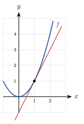

<!-- tillegg: Claude -->
Oppgavene blander grenseverdier, asymptoter, derivasjon og bevegelse. Prøv selv før du åpner løsningen.

:::: {.oppgaver}

::: {.oppgave tittel="Grenseverdi" krever="grenseverdier/grenseverdier"}
Finn $\displaystyle\lim_{x\to 4}\frac{x^2 - 16}{x^2 - 4x}$.

::: {.fasit}
$2$
:::
:::

::: {.oppgave tittel="Asymptoter" krever="grenseverdier/asymptoter"}
Finn asymptotene til $f(x) = \dfrac{6x}{2x - 4}$.

::: {.fasit}
$x = 2$ · $y = 3$
:::
:::

::: {.oppgave tittel="Deriver" krever="derivasjon/derivasjonsregler"}
Deriver: a) $f(x) = 2x^4 - 3x + \dfrac{1}{x}$ b) $g(t) = 5t^2 - 4\sqrt t$

::: {.fasit}
$8x^3 - 3 - \frac{1}{x^2}$ · $10t - \frac{2}{\sqrt t}$
:::
:::

::: {.oppgave tittel="Tangent og normal" niva="Middels" krever="derivasjon/tangenter"}
Finn tangenten og normalen til $f(x) = \sqrt x$ i $x = 4$.

::: {.fasit}
$y = \frac14 x + 1$ · $y = -4x + 18$
:::
:::

::: {.oppgave tittel="Heis" niva="Utfordrende" krever="anvendelser-derivasjon/fart-og-akselerasjon"}
En heis starter fra ro, og posisjonen de første $4.0\ \mathrm{s}$ er $s(t) = 0.75t^2 - 0.125t^3$ (meter, sekunder). a) Finn farten og akselerasjonen. b) Når er farten størst, og hvor stor er den? c) Når er akselerasjonen null?

::: {.fasit}
b) $1.5\ \mathrm{m/s}$ · c) $t = 2.0\ \mathrm{s}$
:::
:::

::: {.oppgave tittel="Stigningstall fra tangenten" krever="derivasjon/tangenter"}
<!-- tillegg: Claude -->
{.tikz-fig style="width:240px"}

Figuren viser grafen til $f(x) = x^2$ og tangenten i $x = 1$. Les av stigningstallet til tangenten, og sammenlign med $f'(1)$.

::: {.fasit}
$2$
:::
:::

::::
