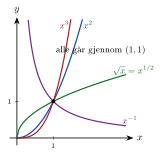

<!-- video: kommer (videoer/matte-forkurs/07-04-potens-og-rotfunksjoner) -->
{fig-alt="Video kommer"}

<!-- tillegg: Claude -->
En **potensfunksjon** har formen $f(x) = a\cdot x^b$, der eksponenten $b$ kan være et hvilket som helst tall. Mange sammenhenger i naturen er slike: Arealet av en sirkel er $\pi r^2$, gravitasjonskraften avtar som $\frac{1}{r^2}$, og svingetiden for en pendel vokser som $\sqrt L$.

## Formen på grafen

::: {.kort}
- **$b > 1$** Grafen vokser raskere og raskere ($x^2$, $x^3$). Krummer oppover for $x > 0$.
- **$0 < b < 1$** Grafen vokser, men saktere og saktere ($\sqrt x = x^{1/2}$). Krummer nedover.
- **$b < 0$** Grafen avtar mot null ($\frac1x = x^{-1}$, $\frac{1}{x^2}$), med asymptoter langs aksene.
:::

For $x > 0$ går alle grafene $y = x^b$ gjennom punktet $(1, 1)$.

<!-- tillegg: Claude -->
{.tikz-fig style="width:380px"}

## Rotfunksjoner

$f(x) = \sqrt x = x^{1/2}$ er bare definert for $x \ge 0$. Potensregelen for derivasjon gjelder:
$$
\left(\sqrt x\right)' = \left(x^{1/2}\right)' = \frac12 x^{-1/2} = \frac{1}{2\sqrt x}
$$
Den deriverte blir veldig stor nær $x = 0$: Grafen starter loddrett.

::: {.eksempel}
**Eksempel: Drøft en rotfunksjon.** Drøft $f(x) = x - 2\sqrt x$ for $x \ge 0$.

::: {.losning}
$f'(x) = 1 - \frac{1}{\sqrt x}$. $f'(x) = 0$ gir $\sqrt x = 1$, altså $x = 1$. For $0 < x < 1$ er $\frac{1}{\sqrt x} > 1$, så $f' < 0$. For $x > 1$ er $f' > 0$.

$f$ avtar på $[0, 1]$ og vokser for $x > 1$. Bunnpunkt $\underline{\underline{(1, -1)}}$. Nullpunkter: $x = 2\sqrt x$ gir $x = 0$ og $x = 4$.
:::
:::

::: {.callout-tip title="Proporsjonalitet i fysikken"}
Skriver vi $y \propto x^b$, betyr det at $y$ er proporsjonal med $x^b$. Dobles $x$, blir $y$ ganget med $2^b$. For en pendel er $T \propto \sqrt L$, så fire ganger så lang pendel gir dobbelt så lang svingetid. Se [fjær og pendel på fysikkhjelp.no](https://fysikkhjelp.no/fysikk-forkurs/kapitler/07-svingninger/02-fjaer-og-pendel.html).
:::

::: {.eksempel}
<!-- tillegg: Claude -->
**Eksempel: Derivere en rot.** Deriver $f(x) = \sqrt[3]{x^2}$. Hva skjer i $x = 0$?

::: {.losning}
Skriv roten som potens: $f(x) = x^{2/3}$. Potensregelen gir
$$
f'(x) = \tfrac23x^{-1/3} = \underline{\underline{\frac{2}{3\sqrt[3]{x}}}}
$$
I $x = 0$ er den deriverte ikke definert. Grafen har en spiss der: Tangenten blir loddrett.
:::
:::

:::: {.oppgaver}

::: {.oppgave tittel="Deriver"}
a) $f(x) = 4x^{3/2}$ b) $g(x) = \dfrac{6}{\sqrt x}$ c) $h(x) = 2\sqrt[3]{x}$

::: {.fasit}
$6x^{1/2} = 6\sqrt x$ · $-3x^{-3/2}$ · $\frac23 x^{-2/3}$
:::
:::

::: {.oppgave tittel="Gravitasjon" niva="Middels"}
Gravitasjonskraften på en satellitt er $F = \dfrac{k}{r^2}$. Hvor mye mindre blir kraften når avstanden til jordsenteret tredobles?

::: {.fasit}
$9 \text{ ganger mindre}$
:::
:::

::: {.oppgave tittel="Drøfting" niva="Utfordrende"}
Finn bunnpunktet til $f(x) = x + \dfrac{4}{x}$ for $x > 0$.

::: {.fasit}
$(2, 4)$
:::
:::

::::
