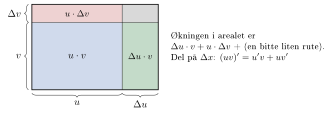

<!-- video: kommer (videoer/matte-forkurs/07-06-produkt-og-kvotientregelen) -->
{fig-alt="Video kommer"}

<!-- tillegg: Claude -->
Den deriverte av en sum er summen av de deriverte. Men den deriverte av et produkt er **ikke** produktet av de deriverte. For produkter og brøker trenger vi egne regler.

## Produktregelen

::: {.graa}
$$
(u\cdot v)' = u'\cdot v + u\cdot v'
$$
:::

Deriver den ene faktoren og la den andre stå, og legg til omvendt.

<!-- tillegg: Claude -->
{.tikz-fig style="width:540px"}

::: {.eksempel}
**Eksempel: Produktregelen.** Deriver $f(x) = x^2\sqrt{x + 1}$.

::: {.losning}
$u = x^2$, $u' = 2x$. $v = \sqrt{x + 1}$, $v' = \frac{1}{2\sqrt{x + 1}}$ (kjerneregelen).
$$
f'(x) = 2x\sqrt{x + 1} + x^2\cdot\frac{1}{2\sqrt{x + 1}} = \frac{4x(x + 1) + x^2}{2\sqrt{x + 1}} = \underline{\underline{\frac{5x^2 + 4x}{2\sqrt{x + 1}}}}
$$
:::
:::

## Kvotientregelen

::: {.graa}
$$
\left(\frac{u}{v}\right)' = \frac{u'\cdot v - u\cdot v'}{v^2}
$$
:::

Rekkefølgen i telleren er viktig, fordi det er et minustegn. Huskeregel: «derivert teller ganger nevner, minus teller ganger derivert nevner, over nevner i andre».

::: {.eksempel}
**Eksempel: Kvotientregelen.** Deriver $g(x) = \dfrac{2x + 1}{x - 3}$.

::: {.losning}
$u = 2x + 1$, $u' = 2$. $v = x - 3$, $v' = 1$.
$$
g'(x) = \frac{2(x - 3) - (2x + 1)\cdot 1}{(x - 3)^2} = \underline{\underline{\frac{-7}{(x - 3)^2}}}
$$
Den deriverte er alltid negativ, så $g$ avtar overalt der den er definert.
:::
:::

::: {.callout-tip title="Skriv om når det går"}
$\dfrac{3}{x^2}$ deriveres enklere som $3x^{-2}$ enn med kvotientregelen. Bruk kvotientregelen når det står $x$ i både teller og nevner.
:::

:::: {.oppgaver}

::: {.oppgave tittel="Produktregelen"}
Deriver: a) $(x^2 + 1)(3x - 2)$ b) $x\sqrt x$ (på to måter)

::: {.fasit}
a) $9x^2 - 4x + 3$ · b) $\frac32\sqrt x$
:::
:::

::: {.oppgave tittel="Kvotientregelen"}
Deriver: a) $\dfrac{x}{x + 1}$ b) $\dfrac{x^2}{x - 2}$

::: {.fasit}
a) $\frac{1}{(x + 1)^2}$ · b) $\frac{x^2 - 4x}{(x - 2)^2}$
:::
:::

::: {.oppgave tittel="Drøfting" niva="Middels"}
Finn ekstremalpunktene til $f(x) = \dfrac{x^2}{x - 2}$ (bruk svaret over).

::: {.fasit}
$(0, 0)$ · $(4, 8)$
:::
:::

::: {.oppgave tittel="Effekt i en krets" niva="Utfordrende"}
Effekten i en motstand $R$ koblet til et batteri med indre resistans $r$ er $P(R) = \dfrac{E^2 R}{(R + r)^2}$. Vis at effekten er størst når $R = r$.

:::

::::
