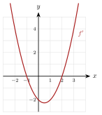

<!-- tillegg: Claude -->
Oppgavene blander derivasjonsreglene, drøfting og optimering. Prøv selv før du åpner løsningen.

:::: {.oppgaver}

::: {.oppgave tittel="Deriver" krever="derivasjon/kjerneregelen, derivasjon/produkt-og-kvotient"}
a) $f(x) = (x^2 - 1)^3$ b) $g(x) = x(2x + 1)^2$ c) $h(x) = \dfrac{x - 1}{x^2}$

::: {.fasit}
a) $6x(x^2 - 1)^2$ · b) $(2x + 1)(6x + 1)$ · c) $\frac{2 - x}{x^3}$
:::
:::

::: {.oppgave tittel="Drøft" niva="Middels" krever="anvendelser-derivasjon/drofting"}
Drøft $f(x) = x^4 - 4x^3$: ekstremalpunkter og vendepunkter.

::: {.fasit}
$(3, -27)$ · $(0, 0) \text{ og } (2, -16)$
:::
:::

::: {.oppgave tittel="Billigste rør" niva="Middels" krever="anvendelser-derivasjon/optimering"}
En lukket kasse med kvadratisk bunn skal ha volum $32\ \mathrm{dm^3}$. Hvilke mål gir minst overflate?

::: {.fasit}
$\text{kube med side } 3.17\ \mathrm{dm}$
:::
:::

::: {.oppgave tittel="Lys fra en lampe" niva="Utfordrende" krever="anvendelser-derivasjon/optimering, derivasjon/kjerneregelen"}
Belysningsstyrken på et bord fra en lampe i høyden $h$ over bordkanten, i horisontal avstand $1.0\ \mathrm{m}$, er proporsjonal med $B(h) = \dfrac{h}{(h^2 + 1)^{3/2}}$. Hvilken høyde gir sterkest lys på bordkanten?

::: {.fasit}
$0.71\ \mathrm{m}$
:::
:::

::: {.oppgave tittel="Fra f′ til f" niva="Middels" krever="anvendelser-derivasjon/drofting"}
<!-- tillegg: Claude -->
{.tikz-fig style="width:260px"}

Figuren viser grafen til den **deriverte** $f'$. Hvor vokser $f$, og hvor avtar den? Har $f$ topp- eller bunnpunkter?

:::

::::
