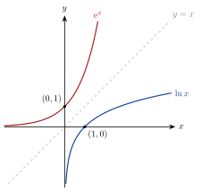

<!-- video: kommer (videoer/matte-forkurs/08-04-funksjonen-ln-x) -->
{fig-alt="Video kommer"}

<!-- tillegg: Claude -->
Logaritmefunksjonen $f(x) = \ln x$ vokser, men saktere og saktere. Den er det speilvendte bildet av $\mathrm{e}^x$ om linja $y = x$. Her ser vi på grafen, finner den deriverte og drøfter funksjoner som inneholder $\ln x$.

## Grafen

{.tikz-fig style="width:400px" fig-alt="Grafene til e opphøyd i x og ln x, speilet om den stiplede linja y = x. ln x går gjennom (1, 0) og har y-aksen som vertikal asymptote."}

::: {.kort}
- **Definisjonsmengde** $x > 0$. Verdimengde: alle reelle tall.
- **Nullpunkt** $\ln 1 = 0$, så grafen går gjennom $(1, 0)$.
- **Asymptote** $\ln x \to -\infty$ når $x \to 0^+$, så $y$-aksen er en vertikal asymptote.
- **Vekst** $\ln x$ vokser mot uendelig, men svært sakte: $\ln 1000 \approx 6.9$.
:::

## Den deriverte

::: {.graa}
$$
(\ln x)' = \frac1x \qquad\qquad \big(\ln u\big)' = \frac{u'}{u} \quad\text{(med kjerneregelen)}
$$
:::

Den deriverte er positiv for alle $x > 0$, så $\ln x$ vokser overalt. Og $\frac1x$ blir mindre og mindre, så veksten avtar.

::: {.eksempel}
**Eksempel: Drøfting.** Finn bunnpunktet til $f(x) = x - \ln x$.

::: {.losning}
$f'(x) = 1 - \frac1x = \frac{x - 1}{x}$. For $x > 0$ er nevneren positiv, så $f' < 0$ for $x < 1$ og $f' > 0$ for $x > 1$.

Bunnpunkt: $f(1) = 1 - 0 = 1$, altså $\underline{\underline{(1, 1)}}$. Dette viser at $x - \ln x \ge 1$, altså $\ln x \le x - 1$ for alle $x > 0$.
:::
:::

::: {.eksempel}
**Eksempel: Kjerneregelen.** Deriver $g(x) = \ln(x^2 + 1)$ og $h(x) = x\ln x$.

::: {.losning}
$g'(x) = \dfrac{2x}{x^2 + 1}$.

Produktregelen: $h'(x) = 1\cdot\ln x + x\cdot\frac1x = \underline{\underline{\ln x + 1}}$.
:::
:::

:::: {.oppgaver}

::: {.oppgave tittel="Deriver"}
a) $\ln(3x)$ b) $\ln(x^2)$ c) $\dfrac{\ln x}{x}$

::: {.losning}
a) $\frac{3}{3x} = \underline{\underline{\frac1x}}$ (fordi $\ln 3x = \ln 3 + \ln x$)

b) $\frac{2x}{x^2} = \underline{\underline{\frac2x}}$

c) $\frac{\frac1x\cdot x - \ln x}{x^2} = \underline{\underline{\frac{1 - \ln x}{x^2}}}$
:::
:::

::: {.oppgave tittel="Toppunkt" niva="Middels"}
Finn toppunktet til $f(x) = \dfrac{\ln x}{x}$.

::: {.losning}
$f'(x) = \frac{1 - \ln x}{x^2} = 0$ gir $\ln x = 1$, altså $x = \mathrm{e}$. $f'$ skifter fra pluss til minus. Toppunkt $\underline{\underline{\left(\mathrm{e}, \frac{1}{\mathrm{e}}\right) \approx (2.72,\ 0.368)}}$.
:::
:::

::: {.oppgave tittel="Definisjonsmengde" niva="Utfordrende"}
Finn definisjonsmengden og nullpunktene til $f(x) = \ln(4 - x^2)$.

::: {.losning}
$4 - x^2 > 0$ gir $\underline{\underline{-2 < x < 2}}$. Nullpunkter: $4 - x^2 = 1$, så $\underline{\underline{x = \pm\sqrt3}}$.
:::
:::

::::
