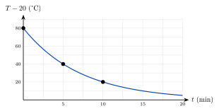

<!-- tillegg: Claude -->
Oppgavene blander logaritmer, likninger og eksponentielle modeller. Prøv selv før du åpner løsningen.

:::: {.oppgaver}

::: {.oppgave tittel="Logaritmereglene" krever="eksponential-og-logaritme/logaritmer, eksponential-og-logaritme/ln-og-e"}
Skriv som én logaritme: $\ln 8 - 2\ln 2 + \ln 3$.

::: {.losning}
$\ln\frac{8\cdot 3}{4} = \underline{\underline{\ln 6}}$
:::
:::

::: {.oppgave tittel="Likninger" krever="eksponential-og-logaritme/eksponentiallikninger, eksponential-og-logaritme/ln-og-e"}
Løs: a) $5\mathrm{e}^{x} = 20$ b) $\ln(x + 2) = \ln(3x - 4)$

::: {.losning}
a) $\mathrm{e}^x = 4$, så $x = \ln 4 = \underline{\underline{1.39}}$

b) $x + 2 = 3x - 4$, så $\underline{\underline{x = 3}}$ (begge sider definert: $5 > 0$).
:::
:::

::: {.oppgave tittel="Befolkning" niva="Middels" krever="eksponential-og-logaritme/eksponentiallikninger"}
En by har 40000 innbyggere og vokser med 1.5 % per år. Når passerer den 50000?

::: {.losning}
$40000\cdot 1.015^t = 50000$ gir $1.015^t = 1.25$ og $t = \frac{\ln 1.25}{\ln 1.015} = \underline{\underline{15 \text{ år}}}$.
:::
:::

::: {.oppgave tittel="Medisin i blodet" niva="Middels" krever="eksponential-og-logaritme/ln-og-e, eksponential-og-logaritme/drofting"}
Konsentrasjonen av et legemiddel er $C(t) = 8.0\mathrm{e}^{-0.35t}$ (mg/L, timer). a) Finn halveringstiden. b) Hvor fort synker konsentrasjonen etter 2.0 timer?

::: {.losning}
a) $t = \frac{\ln 2}{0.35} = \underline{\underline{2.0 \text{ timer}}}$

b) $C'(t) = -2.8\mathrm{e}^{-0.35t}$, $C'(2.0) = -2.8\mathrm{e}^{-0.70} = \underline{\underline{-1.4\ \mathrm{mg/(L\cdot h)}}}$
:::
:::

::: {.oppgave tittel="Toppunkt" niva="Utfordrende" krever="eksponential-og-logaritme/drofting"}
Effekten av et medikament er $E(t) = 10t\,\mathrm{e}^{-0.5t}$. Når er effekten størst, og hvor stor er den?

::: {.losning}
$E'(t) = 10\mathrm{e}^{-0.5t}(1 - 0.5t) = 0$ gir $t = 2$. $E(2) = 20\mathrm{e}^{-1} = \underline{\underline{7.4}}$ ved $\underline{\underline{t = 2}}$.
:::
:::

::: {.oppgave tittel="Avkjøling fra graf" niva="Middels" krever="eksponential-og-logaritme/eksponentiallikninger"}
<!-- tillegg: Claude -->
{.tikz-fig style="width:340px"}

Grafen viser hvor mye varmere enn rommet en kopp te er. Les av hvor lang tid det tar før temperaturforskjellen halveres, og lag en modell $T - 20 = 80\cdot\left(\frac12\right)^{t/T_{1/2}}$. Når er forskjellen $5\ ^\circ\mathrm{C}$?

::: {.losning}
Forskjellen går fra 80 til 40 på 5 minutter, og fra 40 til 20 på nye 5: halveringstiden er $\underline{\underline{5\ \mathrm{min}}}$. Modell: $T - 20 = 80\cdot0.5^{t/5}$.

$80\cdot0.5^{t/5} = 5$ gir $0.5^{t/5} = \frac1{16} = 0.5^4$, så $t/5 = 4$ og $\underline{\underline{t = 20\ \mathrm{min}}}$.
:::
:::

::::
