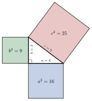

<!-- video: kommer (videoer/matte-forkurs/09-01-pytagorassetningen) -->
{fig-alt="Video kommer"}

<!-- tillegg: Claude -->
Pytagorassetningen er kanskje den mest brukte setningen i hele matematikken. Den gir sammenhengen mellom sidene i en rettvinklet trekant, og den er grunnlaget for å regne ut avstander, lengden av vektorer og størrelsen av krefter og farter.

## Setningen

::: {.graa}
I en rettvinklet trekant med katetene $a$ og $b$ og hypotenusen $c$ er
$$
a^2 + b^2 = c^2
$$
:::

**Hypotenusen** er den lengste siden, den som ligger rett overfor den rette vinkelen. **Katetene** er de to sidene som danner den rette vinkelen.

Setningen gjelder også omvendt: Har en trekant sider som oppfyller $a^2 + b^2 = c^2$, er den rettvinklet. Byggefolk har lenge brukt «3–4–5-regelen» for å lage rette vinkler: $3^2 + 4^2 = 25 = 5^2$.

## Et bevis med figurer

Legg fire like rettvinklede trekanter inni et kvadrat med side $a + b$, slik at det blir et skjevt kvadrat med side $c$ i midten. Arealet av det store kvadratet kan regnes ut på to måter:
$$
(a + b)^2 = 4\cdot\tfrac12 ab + c^2 \quad\Longrightarrow\quad a^2 + 2ab + b^2 = 2ab + c^2 \quad\Longrightarrow\quad a^2 + b^2 = c^2
$$

::: {.eksempel}
**Eksempel: Finn en side.** En stige som er $5.0\ \mathrm{m}$ lang, står mot en vegg med foten $1.4\ \mathrm{m}$ fra veggen. Hvor høyt opp på veggen når den?

::: {.losning}
Stigen er hypotenusen: $h^2 + 1.4^2 = 5.0^2$, så
$$
h = \sqrt{25 - 1.96} = \sqrt{23.04} = \underline{\underline{4.8\ \mathrm{m}}}
$$
:::
:::

<!-- tillegg: Claude -->
{.tikz-fig style="width:300px"}

## Avstand mellom to punkter

Avstanden mellom $(x_1, y_1)$ og $(x_2, y_2)$ er hypotenusen i en trekant med katetene $\Delta x$ og $\Delta y$:

::: {.graa}
$$
d = \sqrt{(x_2 - x_1)^2 + (y_2 - y_1)^2}
$$
:::

::: {.callout-tip title="I fysikken"}
Lengden av en vektor $\vec F = [F_x, F_y]$ er $|\vec F| = \sqrt{F_x^2 + F_y^2}$. Det er Pytagoras. Se [vektorer på fysikkhjelp.no](https://fysikkhjelp.no/fysikk-forkurs/kapitler/02-matematikk/04-vektorer.html).
:::

::: {.eksempel}
<!-- tillegg: Claude -->
**Eksempel: Avstand.** Finn avstanden mellom punktene $(2, 1)$ og $(7, 13)$.

::: {.losning}
Forskjellen i $x$ er $5$ og i $y$ er $12$. Det er katetene i en rettvinklet trekant:
$$
d = \sqrt{5^2 + 12^2} = \sqrt{169} = \underline{\underline{13}}
$$
:::
:::

:::: {.oppgaver}

::: {.oppgave tittel="Hypotenusen"}
Katetene er $6.0\ \mathrm{cm}$ og $8.0\ \mathrm{cm}$. Finn hypotenusen.

::: {.fasit}
$10\ \mathrm{cm}$
:::
:::

::: {.oppgave tittel="Avstand"}
Finn avstanden mellom $(-1, 2)$ og $(5, 10)$.

::: {.fasit}
$10$
:::
:::

::: {.oppgave tittel="Er den rettvinklet?" niva="Middels"}
Er en trekant med sidene $7$, $24$ og $25$ rettvinklet? Hva med $5$, $6$ og $8$?

:::

::: {.oppgave tittel="Diagonalen i en boks" niva="Utfordrende"}
En boks er $30\ \mathrm{cm}$ lang, $20\ \mathrm{cm}$ bred og $12\ \mathrm{cm}$ høy. Hvor lang er romdiagonalen?

::: {.fasit}
$38\ \mathrm{cm}$
:::
:::

::::
