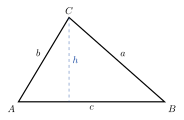

<!-- video: kommer (videoer/matte-forkurs/09-03-arealsetningen) -->
{fig-alt="Video kommer"}

<!-- tillegg: Claude -->
Arealet av en trekant er $\frac12\cdot\text{grunnlinje}\cdot\text{høyde}$. Men ofte kjenner vi ikke høyden, bare to sider og vinkelen mellom dem. Da gir **arealsetningen** arealet direkte.

{.tikz-fig style="width:340px" fig-alt="En vilkårlig trekant ABC. Siden a ligger overfor A, b overfor B og c overfor C. En stiplet høyde h går fra C ned til siden c."}

Vi navngir sidene etter hjørnet de ligger **overfor**: Siden $a$ ligger overfor hjørnet $A$, og så videre.

## Setningen

Høyden fra $C$ ned på $c$ er $h = b\sin A$ (se den rettvinklede trekanten til venstre i figuren). Da er arealet $\frac12 c\cdot h = \frac12 bc\sin A$:

::: {.graa}
$$
T = \tfrac12 bc\sin A = \tfrac12 ac\sin B = \tfrac12 ab\sin C
$$
:::

Huskeregel: halvparten av to sider ganger sinus til vinkelen **mellom** dem.

::: {.eksempel}
**Eksempel: Tomta.** En trekantet tomt har to sider på $40\ \mathrm{m}$ og $55\ \mathrm{m}$, med $62^\circ$ mellom dem. Hvor stor er tomta?

::: {.losning}
$$
T = \tfrac12\cdot 40\ \mathrm{m}\cdot 55\ \mathrm{m}\cdot\sin 62^\circ = \underline{\underline{971\ \mathrm{m^2}}}
$$
:::
:::

Setningen virker også for stumpe vinkler, fordi $\sin v$ er definert for vinkler over $90^\circ$ (se kapitlet om enhetssirkelen). For eksempel er $\sin 150^\circ = \sin 30^\circ = \frac12$.

:::: {.oppgaver}

::: {.oppgave tittel="Areal"}
Finn arealet av en trekant med $a = 8.0$, $b = 6.0$ og $C = 45^\circ$.

::: {.losning}
$\frac12\cdot 8.0\cdot 6.0\cdot\sin 45^\circ = \underline{\underline{17}}$
:::
:::

::: {.oppgave tittel="Finn vinkelen" niva="Middels"}
En trekant har areal $20\ \mathrm{cm^2}$ og to sider på $8.0\ \mathrm{cm}$ og $10\ \mathrm{cm}$. Hvor stor kan vinkelen mellom dem være?

::: {.losning}
$\sin v = \frac{2\cdot 20}{8.0\cdot 10} = 0.50$. Det gir $\underline{\underline{v = 30^\circ}}$ eller $\underline{\underline{v = 150^\circ}}$. Begge trekantene finnes.
:::
:::

::: {.oppgave tittel="Sekskant" niva="Utfordrende"}
En regulær sekskant har side $s$. Del den i seks likesidede trekanter, og vis at arealet er $\frac{3\sqrt3}{2}s^2$.

::: {.losning}
Hver trekant har to sider $s$ med $60^\circ$ mellom: $\frac12 s^2\sin 60^\circ = \frac{\sqrt3}{4}s^2$. Seks av dem: $\frac{6\sqrt3}{4}s^2 = \frac{3\sqrt3}{2}s^2$.
:::
:::

::::
