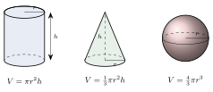

<!-- video: kommer (videoer/matte-forkurs/09-05-areal-og-volum) -->
{fig-alt="Video kommer"}

<!-- tillegg: Claude -->
Hvor mye vann er det i et basseng? Hvor mye maling trengs til en tank? Hvor stor masse har en stålkule? Svarene krever volum og overflate av romfigurer. Formlene er få, og de henger logisk sammen.

## Volum

::: {.kort}
- **Prisme og sylinder** Grunnflate ganger høyde: $V = G\cdot h$. For en sylinder med radius $r$: $V = \pi r^2 h$.
- **Pyramide og kjegle** En tredjedel av prismet med samme grunnflate og høyde: $V = \frac13 G\cdot h$. For en kjegle: $V = \frac13\pi r^2 h$.
- **Kule** $V = \frac43\pi r^3$.
:::

<!-- tillegg: Claude -->
{.tikz-fig style="width:520px"}

## Overflate

::: {.graa}
| Figur | Overflate |
|:---|:---|
| Rett prisme | $2G + \text{omkrets}\cdot h$ |
| Sylinder | $2\pi r^2 + 2\pi rh$ |
| Kjegle (sidekant $s$) | $\pi r^2 + \pi rs$ |
| Kule | $4\pi r^2$ |
:::

Den krumme flaten i en sylinder er et rektangel som er rullet sammen: bredden er omkretsen $2\pi r$, og høyden er $h$.

::: {.eksempel}
**Eksempel: Stålkule.** En stålkule har diameter $4.0\ \mathrm{cm}$. Stål har massetettheten $7.9\ \mathrm{g/cm^3}$. Hva er massen?

::: {.losning}
$r = 2.0\ \mathrm{cm}$, så $V = \frac43\pi\cdot 2.0^3 = 33.5\ \mathrm{cm^3}$. Massen er $m = \rho V = 7.9\cdot 33.5 = \underline{\underline{2.6\cdot 10^2\ \mathrm{g}}}$.
:::
:::

::: {.callout-tip title="Skalering"}
Dobles alle lengder, blir arealer $2^2 = 4$ ganger så store og volumer $2^3 = 8$ ganger så store. Derfor har små dyr stor overflate i forhold til volumet, og mister varme raskt.
:::

::: {.callout-tip title="I fysikken"}
Volum og massetetthet trengs for trykk og oppdrift. Se [oppdrift og Arkimedes' lov på fysikkhjelp.no](https://fysikkhjelp.no/fysikk-forkurs/kapitler/08-fluider/04-oppdrift-og-arkimedes-lov.html).
:::

::: {.eksempel}
<!-- tillegg: Claude -->
**Eksempel: Iskremkjeks.** En kjeks har form som en kjegle med radius $3.0\ \mathrm{cm}$ og høyde $10\ \mathrm{cm}$. Hvor mye iskrem får plass i den (uten topp)?

::: {.losning}
$$
V = \tfrac13\pi r^2h = \tfrac13\pi\cdot3.0^2\cdot10\ \mathrm{cm^3} = \underline{\underline{94\ \mathrm{cm^3}}}
$$
Det er knapt en desiliter.
:::
:::

:::: {.oppgaver}

::: {.oppgave tittel="Sylinder"}
En sylindertank har radius $1.5\ \mathrm{m}$ og høyde $4.0\ \mathrm{m}$. Finn volumet i liter.

::: {.fasit}
$2.8\cdot 10^4\ \mathrm{L}$
:::
:::

::: {.oppgave tittel="Kjegle"}
En iskremkjeks er en kjegle med radius $2.5\ \mathrm{cm}$ og høyde $10\ \mathrm{cm}$. Hvor mye rommer den?

::: {.fasit}
$65\ \mathrm{cm^3}$
:::
:::

::: {.oppgave tittel="Jordkloden" niva="Middels"}
Jordas radius er $6.37\cdot 10^6\ \mathrm{m}$. Finn overflaten og volumet.

::: {.fasit}
$5.10\cdot 10^{14}\ \mathrm{m^2}$ · $1.08\cdot 10^{21}\ \mathrm{m^3}$
:::
:::

::: {.oppgave tittel="Kule i sylinder" niva="Utfordrende"}
En kule passer akkurat inni en sylinder (samme radius $r$, og høyden er $2r$). Hvor stor del av sylinderens volum fyller kula?

::: {.fasit}
$\frac23$
:::
:::

::::
