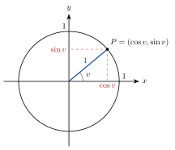

<!-- video: kommer (videoer/matte-forkurs/10-02-enhetssirkelen) -->
{fig-alt="Video kommer"}

<!-- tillegg: Claude -->
I en rettvinklet trekant er alle vinklene mindre enn $90^\circ$. Men vinkler i en rotasjon kan være $150^\circ$, $300^\circ$ eller $1000^\circ$. For å definere sinus og cosinus for alle vinkler bruker vi **enhetssirkelen**: sirkelen med radius 1 og sentrum i origo.

{.tikz-fig style="width:380px" fig-alt="Enhetssirkelen med radius 1. En radius danner vinkelen v med den positive x-aksen og treffer sirkelen i punktet P med koordinatene cos v og sin v."}

## Definisjonen

::: {.callout-note title="Definisjon: Sinus og cosinus for alle vinkler"}
La radien danne vinkelen $v$ med den positive $x$-aksen (mot klokka). Den treffer enhetssirkelen i punktet $P$. Da er
$$
P = (\cos v,\ \sin v) \qquad\text{og}\qquad \tan v = \frac{\sin v}{\cos v}
$$
:::

For spisse vinkler stemmer dette med definisjonen i rettvinklede trekanter, fordi hypotenusen er 1.

::: {.kort}
- **Fortegn** $\cos v$ er positiv i 1. og 4. kvadrant, $\sin v$ i 1. og 2. kvadrant.
- **Enhetsformelen** Pytagoras i sirkelen: $\sin^2 v + \cos^2 v = 1$.
- **Periode** Går vi en hel runde rundt, kommer vi tilbake: $\sin(v + 2\pi) = \sin v$.
- **Symmetri** $\sin(\pi - v) = \sin v$ og $\cos(-v) = \cos v$.
:::

## Eksakte verdier i hele sirkelen

Med symmetrien finner vi verdiene for vinkler i alle kvadrantene fra verdiene for $30^\circ$, $45^\circ$ og $60^\circ$:

::: {.eksempel}
**Eksempel: Bruk symmetrien.** Finn eksakt $\sin\frac{5\pi}{6}$, $\cos\frac{4\pi}{3}$ og $\tan\frac{7\pi}{4}$.

::: {.losning}
$\frac{5\pi}{6} = 150^\circ$ ligger i 2. kvadrant, speilet av $30^\circ$: $\sin 150^\circ = \sin 30^\circ = \underline{\underline{\frac12}}$.

$\frac{4\pi}{3} = 240^\circ$ ligger i 3. kvadrant, $60^\circ$ forbi $180^\circ$: $\cos 240^\circ = -\cos 60^\circ = \underline{\underline{-\frac12}}$.

$\frac{7\pi}{4} = 315^\circ$ ligger i 4. kvadrant: $\sin = -\frac{\sqrt2}{2}$ og $\cos = \frac{\sqrt2}{2}$, så $\tan = \underline{\underline{-1}}$.
:::
:::

:::: {.oppgaver}

::: {.oppgave tittel="Fortegn"}
Hvilket fortegn har: a) $\sin 200^\circ$ b) $\cos 100^\circ$ c) $\tan 300^\circ$

::: {.losning}
a) 3. kvadrant: $\underline{\underline{-}}$ b) 2. kvadrant: $\underline{\underline{-}}$ c) 4. kvadrant, sin negativ og cos positiv: $\underline{\underline{-}}$
:::
:::

::: {.oppgave tittel="Eksakte verdier"}
Finn eksakt: a) $\cos\pi$ b) $\sin\frac{3\pi}{2}$ c) $\cos\frac{3\pi}{4}$ d) $\sin\left(-\frac{\pi}{6}\right)$

::: {.losning}
a) $\underline{\underline{-1}}$ b) $\underline{\underline{-1}}$ c) $\underline{\underline{-\frac{\sqrt2}{2}}}$ d) $\underline{\underline{-\frac12}}$
:::
:::

::: {.oppgave tittel="Enhetsformelen" niva="Middels"}
$v$ ligger i 2. kvadrant og $\sin v = \frac35$. Finn $\cos v$ og $\tan v$.

::: {.losning}
$\cos^2 v = 1 - \frac{9}{25} = \frac{16}{25}$, og cos er negativ i 2. kvadrant: $\underline{\underline{\cos v = -\frac45}}$. $\underline{\underline{\tan v = -\frac34}}$.
:::
:::

::::
