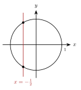

<!-- tillegg: Claude -->
Oppgavene blander radianer, enhetssirkelen og trigonometriske likninger. Prøv selv før du åpner løsningen.

:::: {.oppgaver}

::: {.oppgave tittel="Radianer" krever="trigonometri/radianer-og-enhetssirkelen"}
Et hjul med radius $0.35\ \mathrm{m}$ ruller $10\ \mathrm{m}$. Hvor mange radianer har det rotert, og hvor mange omdreininger er det?

::: {.fasit}
$28.6\ \mathrm{rad}$ · $4.5 \text{ omdreininger}$
:::
:::

::: {.oppgave tittel="Likning" krever="trigonometri/trigonometriske-likninger"}
Løs $2\cos x + 1 = 0$ for $x \in [0, 2\pi\rangle$.

::: {.fasit}
$x = \frac{2\pi}{3} \text{ og } \frac{4\pi}{3}$
:::
:::

::: {.oppgave tittel="Andregrad" niva="Middels" krever="trigonometri/trigonometriske-likninger, algebra-og-likninger/andregradslikninger"}
Løs $\cos^2 x - \cos x = 0$ for $x \in [0, 2\pi\rangle$.

::: {.fasit}
$x = 0,\ \frac{\pi}{2},\ \frac{3\pi}{2}$
:::
:::

::: {.oppgave tittel="Tidevann" niva="Utfordrende" krever="trigonometri/trigonometriske-likninger"}
Vannstanden i en havn er $h(t) = 2.0 + 1.5\cos\left(\frac{2\pi}{12.4}t\right)$ meter, der $t$ er timer etter høyvann. En båt trenger minst $2.5\ \mathrm{m}$ vann. Hvor lenge etter høyvann kan den gå inn?

::: {.fasit}
$2.4 \text{ timer}$
:::
:::

::: {.oppgave tittel="Les av enhetssirkelen" krever="trigonometri/trigonometriske-likninger"}
<!-- tillegg: Claude -->
{.tikz-fig style="width:220px"}

Figuren viser løsningene av en likning på enhetssirkelen. Hvilken likning, og hva er løsningene i $[0, 2\pi\rangle$?

::: {.fasit}
$v = \frac{2\pi}{3}$ · $v = \frac{4\pi}{3}$
:::
:::

::::
