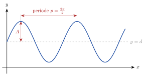

<!-- video: kommer (videoer/matte-forkurs/11-01-sinusfunksjonen) -->
{fig-alt="Video kommer"}

<!-- tillegg: Claude -->
Følger vi punktet på enhetssirkelen rundt og rundt og tegner høyden $\sin x$ mot vinkelen $x$, får vi en bølge som gjentar seg i det uendelige. Sinusfunksjonen er matematikkens modell for alt som svinger: lodd i fjærer, lydbølger, vekselstrøm og dagslengden gjennom året.

## Grafen til sin x

{.tikz-fig style="width:560px" fig-alt="Grafen til f(x) = A sin(kx) + d. Likevektslinja y = d er stiplet. Amplituden A er avstanden fra likevektslinja til toppen. Perioden p er avstanden mellom to topper."}

## Den generelle sinusfunksjonen

::: {.graa}
$$
f(x) = A\sin(kx + c) + d
$$
:::

::: {.kort}
- **Amplitude $|A|$** Halve avstanden mellom topp og bunn.
- **Likevektslinje $y = d$** Linja grafen svinger rundt.
- **Periode $p = \dfrac{2\pi}{k}$** Avstanden mellom to topper. $k$ kalles i fysikken ofte vinkelfrekvensen $\omega$ (når $x$ er tid).
- **Faseforskyvning** $c$ forskyver grafen sidelengs med $-\frac{c}{k}$.
:::

Toppverdien er $d + |A|$ og bunnverdien $d - |A|$.

::: {.eksempel}
**Eksempel: Les av en sinusfunksjon.** Finn amplitude, likevektslinje, periode og topp- og bunnverdi for $f(x) = 3\sin(2x) + 1$.

::: {.losning}
Amplitude $\underline{\underline{3}}$, likevektslinje $\underline{\underline{y = 1}}$, periode $\underline{\underline{\frac{2\pi}{2} = \pi}}$. Toppverdi $1 + 3 = 4$, bunnverdi $1 - 3 = -2$.
:::
:::

::: {.eksempel}
**Eksempel: Lag modellen.** Dagslengden i en by varierer mellom 6 og 18 timer gjennom året (365 dager). Lengst dag er dag 172. Lag en modell.

::: {.losning}
Likevekt $d = \frac{18 + 6}{2} = 12$, amplitude $A = \frac{18 - 6}{2} = 6$, $k = \frac{2\pi}{365}$. Toppen skal være ved dag 172. En cosinus har topp der vinkelen er null, så
$$
D(t) = \underline{\underline{12 + 6\cos\left(\frac{2\pi}{365}(t - 172)\right)}}
$$
(Det er en sinusfunksjon forskjøvet med en kvart periode.)
:::
:::

::: {.callout-tip title="I fysikken"}
Et lodd i en fjær følger $x(t) = A\cos(\omega t)$, med perioden $T = \frac{2\pi}{\omega}$. Se [harmoniske svingninger på fysikkhjelp.no](https://fysikkhjelp.no/fysikk-forkurs/kapitler/07-svingninger/01-harmoniske-svingninger.html).
:::

## Prøv selv

```{.python .kjor}
import numpy as np
import matplotlib.pyplot as plt
A, k, c, d = 3, 2, 0, 1
x = np.linspace(0, 2*np.pi, 400)
plt.plot(x, A*np.sin(k*x + c) + d)
plt.axhline(d, ls="--", color="gray")
plt.grid(True); plt.show()
print("Periode:", 2*np.pi/k)
```

:::: {.oppgaver}

::: {.oppgave tittel="Les av"}
Finn amplitude, periode og likevektslinje: a) $2\sin x - 1$ b) $5\sin(\pi x)$ c) $0.5\sin\left(\frac{x}{2}\right) + 3$

::: {.losning}
a) $2$, $2\pi$, $y = -1$ b) $5$, $2$, $y = 0$ c) $0.5$, $4\pi$, $y = 3$
:::
:::

::: {.oppgave tittel="Finn funksjonen" niva="Middels"}
En sinusfunksjon $f(x) = A\sin(kx) + d$ har toppverdi 7, bunnverdi 1 og periode 4. Finn $A$, $k$ og $d$.

::: {.losning}
$d = 4$, $A = 3$, $k = \frac{2\pi}{4} = \frac{\pi}{2}$: $\underline{\underline{f(x) = 3\sin\left(\frac{\pi}{2}x\right) + 4}}$.
:::
:::

::: {.oppgave tittel="Vekselspenning" niva="Utfordrende"}
Spenningen i stikkontakten er $U(t) = 325\sin(100\pi t)$ volt. Finn amplituden, perioden og frekvensen.

::: {.losning}
Amplitude $\underline{\underline{325\ \mathrm{V}}}$. Periode $T = \frac{2\pi}{100\pi} = \underline{\underline{0.020\ \mathrm{s}}}$. Frekvens $f = \frac1T = \underline{\underline{50\ \mathrm{Hz}}}$.
:::
:::

::::
