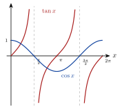

<!-- video: kommer (videoer/matte-forkurs/11-02-cosinus-og-tangensfunksjonen) -->
{fig-alt="Video kommer"}

<!-- tillegg: Claude -->
Cosinusfunksjonen har nøyaktig samme form som sinusfunksjonen, bare forskjøvet en kvart periode. Tangensfunksjonen er helt annerledes: Den har periode $\pi$ og loddrette asymptoter.

## Cosinusfunksjonen

$\cos x$ starter i toppen: $\cos 0 = 1$. Fordi $\cos x = \sin\left(x + \frac{\pi}{2}\right)$, er grafen til cosinus grafen til sinus flyttet $\frac{\pi}{2}$ mot venstre. Alt om amplitude, periode og likevektslinje gjelder på samme måte for
$$
g(x) = A\cos(kx + c) + d
$$

I fysikken velger vi gjerne cosinus når svingningen starter i et ytterpunkt (et lodd som trekkes ut og slippes), og sinus når den starter i likevekt.

<!-- tillegg: Claude -->
{.tikz-fig style="width:420px"}

## Tangensfunksjonen

$\tan x = \dfrac{\sin x}{\cos x}$ er ikke definert der $\cos x = 0$, altså for $x = \frac{\pi}{2} + k\pi$. Der har grafen **loddrette asymptoter**.

::: {.kort}
- **Periode** $\pi$, ikke $2\pi$.
- **Nullpunkter** $x = k\pi$, der $\sin x = 0$.
- **Asymptoter** $x = \frac{\pi}{2} + k\pi$.
- **Verdimengde** Alle reelle tall. Tangens vokser på hele hvert intervall mellom asymptotene.
:::

::: {.eksempel}
**Eksempel: Fra sinus til cosinus.** Skriv $f(x) = 4\sin\left(x + \frac{\pi}{2}\right)$ med cosinus, og finn nullpunktene i $[0, 2\pi]$.

::: {.losning}
$f(x) = 4\cos x$. Nullpunkter: $\cos x = 0$ gir $\underline{\underline{x = \frac{\pi}{2} \text{ og } \frac{3\pi}{2}}}$.
:::
:::

::: {.eksempel}
<!-- tillegg: Claude -->
**Eksempel: Tangens med koeffisient.** Finn perioden og de loddrette asymptotene til $f(x) = \tan(2x)$.

::: {.losning}
$\tan u$ har periode $\pi$, så $\tan(2x)$ har periode $\underline{\underline{\frac\pi2}}$. Asymptotene er der $\cos(2x) = 0$:
$$
2x = \frac\pi2 + k\pi \quad\Rightarrow\quad \underline{\underline{x = \frac\pi4 + k\cdot\frac\pi2}}
$$
:::
:::

## Prøv selv

```{.python .kjor}
import numpy as np
import matplotlib.pyplot as plt
x = np.linspace(-np.pi, np.pi, 800)
y = np.tan(x)
y[np.abs(y) > 10] = np.nan            # ikke tegn over asymptotene
plt.plot(x, np.sin(x), label="sin"); plt.plot(x, np.cos(x), label="cos"); plt.plot(x, y, label="tan")
plt.ylim(-4, 4); plt.legend(); plt.grid(True); plt.show()
```

:::: {.oppgaver}

::: {.oppgave tittel="Cosinus"}
Finn amplitude, periode og toppunktene i $[0, 2\pi]$ for $g(x) = 2\cos(2x)$.

::: {.fasit}
$x = 0,\ \pi,\ 2\pi$
:::
:::

::: {.oppgave tittel="Tangens" niva="Middels"}
Hvor har $h(x) = \tan(2x)$ asymptoter i $\langle 0, \pi\rangle$, og hva er perioden?

::: {.fasit}
$x = \frac{\pi}{4} \text{ og } \frac{3\pi}{4}$ · $\frac{\pi}{2}$
:::
:::

::: {.oppgave tittel="Fjæra" niva="Middels"}
Et lodd trekkes $4.0\ \mathrm{cm}$ ned fra likevekt og slippes. Det svinger med perioden $0.50\ \mathrm{s}$. Skriv posisjonen som funksjon av tiden (positiv oppover).

::: {.fasit}
$y(t) = -4.0\cos\left(\frac{2\pi}{0.50}t\right) = -4.0\cos(4\pi t)$
:::
:::

::::
