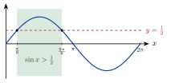

<!-- video: kommer (videoer/matte-forkurs/11-03-trigonometriske-ulikheter) -->
{fig-alt="Video kommer"}

<!-- tillegg: Claude -->
Når er vannstanden over 2.5 meter? Når er spenningen større enn 200 volt? Slike spørsmål er trigonometriske ulikheter. Vi løser dem i to steg: først den tilsvarende likningen, så avgjør vi med grafen eller enhetssirkelen hvilke intervaller som passer.

## Fremgangsmåten

::: {.steg}
1. Løs likningen (med likhetstegn) i det aktuelle intervallet.
2. Tegn grafen, eller bruk enhetssirkelen.
3. Les av intervallene der ulikheten er oppfylt.
:::

::: {.eksempel}
**Eksempel: Sinusulikhet.** Løs $\sin x > \frac12$ for $x \in [0, 2\pi]$.

::: {.losning}
$\sin x = \frac12$ gir $x = \frac{\pi}{6}$ og $x = \frac{5\pi}{6}$. Grafen til $\sin x$ ligger over $\frac12$ mellom disse:
$$
\underline{\underline{\frac{\pi}{6} < x < \frac{5\pi}{6}}}
$$
:::
:::

::: {.eksempel}
**Eksempel: Faktorisering.** Løs $\sin 2x < \sin x$ for $x \in [0, 2\pi]$.

::: {.losning}
$2\sin x\cos x - \sin x < 0$, altså $\sin x(2\cos x - 1) < 0$.

Nullpunkter: $\sin x = 0$ gir $0, \pi, 2\pi$. $\cos x = \frac12$ gir $\frac{\pi}{3}, \frac{5\pi}{3}$. Fortegnslinje:

```{=html}
<div class="graa" style="font-family: monospace; padding: .6rem 1rem; white-space: pre;">x:            0    π/3        π        5π/3    2π
sin x:        0  + + +  + + +  0  − − −  − − −  0
2cos x − 1:   +  + 0 −  − − −  − − −  0 + + +  +
produkt:      0  +  0  − − −   0  + + +  0  − −  0</div>
```

Produktet er negativt for $\underline{\underline{\frac{\pi}{3} < x < \pi \text{ eller } \frac{5\pi}{3} < x < 2\pi}}$.
:::
:::

<!-- tillegg: Claude -->
{.tikz-fig style="width:440px"}

:::: {.oppgaver}

::: {.oppgave tittel="Cosinus"}
Løs $\cos x \le \frac{\sqrt2}{2}$ for $x \in [0, 2\pi]$.

::: {.fasit}
$\frac{\pi}{4} \le x \le \frac{7\pi}{4}$
:::
:::

::: {.oppgave tittel="Tidevann" niva="Middels"}
Vannstanden er $h(t) = 2.0 + 1.5\cos\left(\frac{2\pi}{12.4}t\right)$. I hvilke tidsrom i løpet av de første 12.4 timene er vannstanden over $2.5\ \mathrm{m}$?

::: {.fasit}
$0 \le t < 2.4 \text{ h og } 10.0 \text{ h} < t \le 12.4 \text{ h}$
:::
:::

::::
