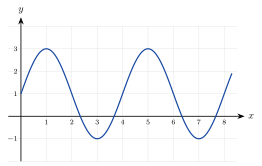

<!-- tillegg: Claude -->
Oppgavene blander sinusfunksjoner, ulikheter og derivasjon. Prøv selv før du åpner løsningen.

:::: {.oppgaver}

::: {.oppgave tittel="Modell" krever="trigonometri/trigonometriske-funksjoner"}
Temperaturen i en by varierer mellom $-4\ ^\circ\mathrm{C}$ og $18\ ^\circ\mathrm{C}$ gjennom året. Lag en modell $T(t) = A\sin(kt + c) + d$ der $t$ er måneder, og forklar hva hver konstant er.

::: {.losning}
$d = 7$, $A = 11$, $k = \frac{2\pi}{12} = \frac{\pi}{6}$. Konstanten $c$ bestemmer når toppen kommer. Er det varmest i juli ($t = 7$), må $\frac{\pi}{6}\cdot 7 + c = \frac{\pi}{2}$, så $c = -\frac{2\pi}{3}$:
$$
\underline{\underline{T(t) = 11\sin\left(\frac{\pi}{6}t - \frac{2\pi}{3}\right) + 7}}
$$
:::
:::

::: {.oppgave tittel="Derivert" niva="Middels" krever="derivasjon/eksponential-og-trig, derivasjon/tangenter"}
Finn likningen for tangenten til $f(x) = \sin x$ i $x = 0$, og forklar hvorfor $\sin x \approx x$ for små $x$.

::: {.losning}
$f(0) = 0$ og $f'(0) = \cos 0 = 1$. Tangenten er $\underline{\underline{y = x}}$. Nær $x = 0$ ligger grafen nesten oppå tangenten, så $\sin x \approx x$ (med $x$ i radianer). Det brukes for pendelen med små utslag.
:::
:::

::: {.oppgave tittel="Vekselstrøm" niva="Utfordrende" krever="trigonometri/trigonometriske-funksjoner, trigonometri/trigonometriske-likninger"}
Spenningen er $U(t) = 325\sin(100\pi t)$. Hvor stor del av tiden er $|U| > 230\ \mathrm{V}$?

::: {.losning}
I én halvperiode er $\sin(100\pi t) > \frac{230}{325} = 0.708$ når vinkelen $100\pi t$ ligger mellom $\sin^{-1} 0.708 = 0.787$ og $\pi - 0.787 = 2.354$. Det er $\frac{2.354 - 0.787}{\pi} = 0.499$ av halvperioden. Det samme gjelder for negative verdier.

Svaret er omtrent $\underline{\underline{50\ \%}}$ av tiden.
:::
:::

::: {.oppgave tittel="Finn funksjonsuttrykket" niva="Middels" krever="trigonometri/trigonometriske-funksjoner"}
<!-- tillegg: Claude -->
{.tikz-fig style="width:380px"}

Grafen har formen $f(x) = A\sin(kx) + d$. Les av amplitude, likevektslinje og periode, og finn $A$, $k$ og $d$.

::: {.losning}
Toppverdi 3 og bunnverdi $-1$: likevektslinje $d = \frac{3 + (-1)}{2} = 1$ og amplitude $A = 2$. Perioden er 4 (fra topp i $x = 1$ til neste topp i $x = 5$), så $k = \frac{2\pi}{4} = \frac\pi2$.
$$
\underline{\underline{f(x) = 2\sin\left(\tfrac\pi2x\right) + 1}}
$$
:::
:::

::::
