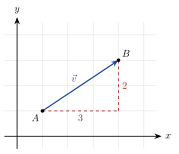

<!-- video: kommer (videoer/matte-forkurs/12-01-vektorer-i-koordinatsystemet) -->
{fig-alt="Video kommer"}

<!-- tillegg: Claude -->
En temperatur er bare et tall. Men en forflytning, en fart eller en kraft har både **størrelse** og **retning**: «5 meter mot nordøst». Slike størrelser kalles **vektorer**. Vi tegner dem som piler, og i et koordinatsystem kan vi regne med dem som tallpar.

## Vektor på koordinatform

En vektor tegnes som en pil. Hvor pila starter, spiller ingen rolle: To piler med samme lengde og retning er den samme vektoren. Vi skriver vektorer med pil over: $\vec v$.

Går pila $3$ enheter mot høyre og $2$ enheter opp, skriver vi
$$
\vec v = [3, 2] = 3\hat{\mathbf{x}} + 2\hat{\mathbf{y}}
$$
der $\hat{\mathbf{x}} = [1, 0]$ og $\hat{\mathbf{y}} = [0, 1]$ er **enhetsvektorene** langs aksene. Tallene $3$ og $2$ kalles **koordinatene** eller **komponentene** til vektoren.

{.tikz-fig style="width:380px" fig-alt="Vektoren v = [3, 2] tegnet som en pil fra punktet A til punktet B. Komponentene 3 langs x-aksen og 2 langs y-aksen er tegnet som stiplede linjer."}

## Vektoren mellom to punkter

Går vektoren fra punktet $A = (x_1, y_1)$ til $B = (x_2, y_2)$, er den

::: {.graa}
$$
\overrightarrow{AB} = [x_2 - x_1,\ y_2 - y_1]
$$
«Endepunkt minus startpunkt».
:::

## Lengden av en vektor

Lengden (størrelsen) finner vi med Pytagoras:

::: {.graa}
$$
|\vec v| = |[x, y]| = \sqrt{x^2 + y^2}
$$
:::

::: {.eksempel}
**Eksempel: Vektor og lengde.** Finn $\overrightarrow{AB}$ og $|\overrightarrow{AB}|$ når $A = (1, -2)$ og $B = (7, 6)$.

::: {.losning}
$\overrightarrow{AB} = [7 - 1, 6 - (-2)] = \underline{\underline{[6, 8]}}$ og $|\overrightarrow{AB}| = \sqrt{36 + 64} = \underline{\underline{10}}$.
:::
:::

::: {.callout-tip title="I fysikken"}
Posisjon, fart, akselerasjon og kraft er vektorer. Se [vektorer på fysikkhjelp.no](https://fysikkhjelp.no/fysikk-forkurs/kapitler/02-matematikk/04-vektorer.html).
:::

:::: {.oppgaver}

::: {.oppgave tittel="Koordinater og lengde"}
Finn $\overrightarrow{AB}$ og lengden når a) $A = (0, 0)$, $B = (-3, 4)$ b) $A = (2, 5)$, $B = (-1, 1)$

::: {.losning}
a) $[-3, 4]$, lengde $\underline{\underline{5}}$ b) $[-3, -4]$, lengde $\underline{\underline{5}}$
:::
:::

::: {.oppgave tittel="Finn endepunktet"}
$\overrightarrow{AB} = [4, -1]$ og $A = (3, 2)$. Finn $B$.

::: {.losning}
$B = (3 + 4, 2 - 1) = \underline{\underline{(7, 1)}}$
:::
:::

::: {.oppgave tittel="Fart" niva="Middels"}
En båt har farten $\vec v = [3.0, 4.0]$ m/s (øst og nord). Hvor stor er farten, og i hvilken retning går båten (vinkel fra øst)?

::: {.losning}
$|\vec v| = \underline{\underline{5.0\ \mathrm{m/s}}}$, retning $\tan^{-1}\frac{4.0}{3.0} = \underline{\underline{53^\circ}}$ nord for øst.
:::
:::

::::
