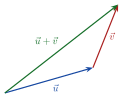

<!-- video: kommer (videoer/matte-forkurs/12-02-regning-med-vektorer) -->
{fig-alt="Video kommer"}

<!-- tillegg: Claude -->
Går du 3 km øst og så 4 km nord, har du flyttet deg 5 km, ikke 7. Vektorer legges sammen ved å sette pilene etter hverandre. På koordinatform er det enkelt: Vi legger sammen komponentene hver for seg.

## Sum, differanse og tall ganger vektor

::: {.kort}
- **Sum** Sett pilene etter hverandre (hale mot spiss). Summen går fra start til slutt: $[a, b] + [c, d] = [a + c,\ b + d]$.
- **Differanse** $\vec u - \vec v = \vec u + (-\vec v)$. Den motsatte vektoren $-\vec v$ har samme lengde, men motsatt retning: $[a, b] - [c, d] = [a - c,\ b - d]$.
- **Tall ganger vektor** $t\cdot[a, b] = [ta,\ tb]$. Vektoren blir $|t|$ ganger så lang. Er $t$ negativ, snur retningen.
:::

{.tikz-fig style="width:360px" fig-alt="To vektorer u og v satt etter hverandre, hale mot spiss. Summen u + v går fra starten av u til spissen av v."}

## Regneregler

Vektorer følger de samme regnereglene som tall når det gjelder sum og tall ganger vektor:
$$
\vec u + \vec v = \vec v + \vec u \qquad (\vec u + \vec v) + \vec w = \vec u + (\vec v + \vec w) \qquad t(\vec u + \vec v) = t\vec u + t\vec v
$$
Derfor kan vi løse vektorlikninger på vanlig måte.

::: {.eksempel}
**Eksempel: Regn ut.** La $\vec u = [2, -1]$ og $\vec v = [-3, 4]$. Finn $2\vec u + \vec v$ og $|\vec u - \vec v|$.

::: {.losning}
$2\vec u + \vec v = [4, -2] + [-3, 4] = \underline{\underline{[1, 2]}}$.

$\vec u - \vec v = [5, -5]$, så $|\vec u - \vec v| = \sqrt{50} = \underline{\underline{5\sqrt2}}$.
:::
:::

::: {.eksempel}
**Eksempel: Kraftsum.** To personer drar i en kasse med kreftene $\vec F_1 = [120, 50]$ N og $\vec F_2 = [80, -90]$ N. Finn summen av kreftene og størrelsen.

::: {.losning}
$\sum\vec F = [200, -40]$ N, og $|\sum\vec F| = \sqrt{200^2 + 40^2} = \underline{\underline{204\ \mathrm{N}}}$.
:::
:::

::: {.callout-tip title="I fysikken"}
Newtons 1. lov sier at en gjenstand er i ro eller har konstant fart når **vektorsummen** av kreftene er null. Se [operasjoner med vektorer](https://fysikkhjelp.no/fysikk-forkurs/kapitler/02-matematikk/05-operasjoner-med-vektorer.html) og [kraftlikevekt](https://fysikkhjelp.no/fysikk-forkurs/kapitler/06-statikk/01-kraftlikevekt-f-0.html) på fysikkhjelp.no.
:::

:::: {.oppgaver}

::: {.oppgave tittel="Regn ut"}
$\vec a = [1, 3]$ og $\vec b = [4, -2]$. Finn a) $\vec a + \vec b$ b) $3\vec a - \vec b$ c) $|\vec a + \vec b|$

::: {.losning}
a) $\underline{\underline{[5, 1]}}$ b) $[3, 9] - [4, -2] = \underline{\underline{[-1, 11]}}$ c) $\underline{\underline{\sqrt{26}}}$
:::
:::

::: {.oppgave tittel="Vektorlikning" niva="Middels"}
Finn $\vec x$ når $2\vec x + [3, -1] = [7, 5]$.

::: {.losning}
$2\vec x = [4, 6]$, så $\underline{\underline{\vec x = [2, 3]}}$.
:::
:::

::: {.oppgave tittel="Likevekt" niva="Middels"}
Tre krefter virker på en ring: $\vec F_1 = [30, 0]$ N, $\vec F_2 = [-10, 25]$ N og en ukjent $\vec F_3$. Ringen er i ro. Finn $\vec F_3$ og størrelsen.

::: {.losning}
Summen er null, så $\vec F_3 = -(\vec F_1 + \vec F_2) = \underline{\underline{[-20, -25]\ \mathrm{N}}}$. Størrelsen er $\sqrt{400 + 625} = \underline{\underline{32\ \mathrm{N}}}$.
:::
:::

::::
