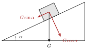

<!-- video: kommer (videoer/matte-forkurs/12-04-parallelle-vektorer-og-dekomponering) -->
{fig-alt="Video kommer"}

<!-- tillegg: Claude -->
To vektorer er parallelle når den ene er et tall ganger den andre. Og enhver vektor kan deles opp i biter langs to gitte retninger. Det kalles **dekomponering**, og det er et av de viktigste verktøyene i mekanikken.

## Parallelle vektorer

::: {.graa}
$\vec u \parallel \vec v$ hvis det finnes et tall $t$ slik at $\vec u = t\vec v$.
:::

På koordinatform betyr det at forholdet mellom komponentene er likt: $[2, 3]$ og $[6, 9]$ er parallelle ($t = 3$), mens $[2, 3]$ og $[6, 8]$ ikke er det.

::: {.eksempel}
**Eksempel: Finn konstanten.** Bestem $s$ slik at $[s, 4]$ er parallell med $[3, 6]$.

::: {.losning}
$[s, 4] = t[3, 6]$ gir $4 = 6t$, så $t = \frac23$, og $s = 3t = \underline{\underline{2}}$.
:::
:::

## Dekomponering

Enhver vektor kan skrives som en sum av to vektorer langs to valgte retninger som ikke er parallelle. Den vanligste dekomponeringen er langs aksene: $\vec v = [v_x, v_y] = v_x\hat{\mathbf{x}} + v_y\hat{\mathbf{y}}$. Med lengde $v$ og vinkel $\alpha$ fra $x$-aksen er
$$
v_x = v\cos\alpha \qquad v_y = v\sin\alpha
$$

Men vi kan velge andre retninger. På et skråplan er det lurt å dekomponere langs planet og vinkelrett på det.

{.tikz-fig style="width:380px" fig-alt="En kasse på et skråplan med helningsvinkel alfa. Tyngden G peker rett ned og er delt i en komponent langs planet, G sin alfa, og en vinkelrett på planet, G cos alfa."}

::: {.eksempel}
**Eksempel: Skråplan.** En kasse med tyngde $G = 300\ \mathrm{N}$ står på et skråplan med helningsvinkel $20^\circ$. Dekomponer tyngden.

::: {.losning}
Langs planet: $G\sin 20^\circ = \underline{\underline{103\ \mathrm{N}}}$. Vinkelrett på planet: $G\cos 20^\circ = \underline{\underline{282\ \mathrm{N}}}$.
:::
:::

## Dekomponering langs vilkårlige vektorer

Skal $\vec w$ skrives som $s\vec u + t\vec v$, får vi to likninger for $s$ og $t$ ved å sammenligne komponentene.

::: {.eksempel}
**Eksempel: To retninger.** Skriv $\vec w = [7, 4]$ som $s[1, 2] + t[3, -1]$.

::: {.losning}
$s + 3t = 7$ og $2s - t = 4$. Fra den andre: $t = 2s - 4$. Sett inn: $s + 6s - 12 = 7$, så $s = \frac{19}{7}$ og $t = \frac{10}{7}$.

$\underline{\underline{\vec w = \tfrac{19}{7}[1, 2] + \tfrac{10}{7}[3, -1]}}$
:::
:::

::: {.callout-tip title="I fysikken"}
Se [krefter i planet og dekomponering på fysikkhjelp.no](https://fysikkhjelp.no/fysikk-forkurs/kapitler/04-krefter/04-krefter-i-planet-dekomponering.html).
:::

:::: {.oppgaver}

::: {.oppgave tittel="Parallelle?"}
Er vektorene parallelle? a) $[4, -6]$ og $[-2, 3]$ b) $[1, 5]$ og $[2, 9]$

::: {.losning}
a) $[4, -6] = -2[-2, 3]$: **ja**. b) $\frac21 \ne \frac95$: **nei**.
:::
:::

::: {.oppgave tittel="Dekomponer"}
En fart på $25\ \mathrm{m/s}$ har retning $40^\circ$ over vannrett. Finn komponentene.

::: {.losning}
$v_x = 25\cos 40^\circ = \underline{\underline{19.2\ \mathrm{m/s}}}$, $v_y = 25\sin 40^\circ = \underline{\underline{16.1\ \mathrm{m/s}}}$.
:::
:::

::: {.oppgave tittel="Akebrett" niva="Middels"}
Et akebrett med tyngde $150\ \mathrm{N}$ trekkes opp en bakke med helning $15^\circ$. Snora er parallell med bakken. Uten friksjon: Hvor stor må snorkraften være for at akebrettet skal gå med konstant fart?

::: {.losning}
Snorkraften må balansere komponenten av tyngden langs bakken: $150\sin 15^\circ = \underline{\underline{38.8\ \mathrm{N}}}$.
:::
:::

::::
