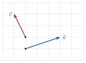

<!-- tillegg: Claude -->
Oppgavene blander koordinater, lengder, sum og dekomponering. Prøv selv før du åpner løsningen.

:::: {.oppgaver}

::: {.oppgave tittel="Midtpunkt" krever="vektorer/vektorer-i-planet"}
Finn midtpunktet $M$ på linjestykket fra $A = (2, -1)$ til $B = (8, 5)$ ved hjelp av vektorer.

::: {.fasit}
$(5, 2)$
:::
:::

::: {.oppgave tittel="Flyet og vinden" niva="Middels" krever="vektorer/vektorer-i-planet, trigonometri/rettvinklet"}
Et fly har farten $\vec v = [250, 0]$ km/h i forhold til lufta. Vinden blåser med $[0, -60]$ km/h. Finn farten i forhold til bakken og vinkelen flyet driver av kurs.

::: {.fasit}
$257\ \mathrm{km/h}$ · $13.5^\circ$
:::
:::

::: {.oppgave tittel="Lampe i to snorer" niva="Utfordrende" krever="vektorer/dekomponering"}
En lampe med tyngde $G = 40\ \mathrm{N}$ henger i to snorer som begge danner $30^\circ$ med vannrett. Finn snorkraften $S$ i hver snor.

::: {.fasit}
$40\ \mathrm{N}$
:::
:::

::: {.oppgave tittel="Vektorer i rutenett" krever="vektorer/vektorer-i-planet"}
<!-- tillegg: Claude -->
{.tikz-fig style="width:240px"}

Hver rute er 1. Les av koordinatene til $\vec u$ og $\vec v$. Finn $\vec u + \vec v$ og $|\vec u - \vec v|$.

::: {.fasit}
$[2, 3]$ · $\sqrt{17} \approx 4.1$
:::
:::

::::
