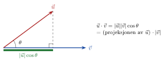

<!-- video: kommer (videoer/matte-forkurs/13-01-skalarproduktet) -->
{fig-alt="Video kommer"}

<!-- tillegg: Claude -->
Drar du en kasse med et tau på skrå, er det bare den delen av kraften som peker i bevegelsesretningen, som gjør arbeid. **Skalarproduktet** måler nettopp dette: hvor mye to vektorer peker samme vei. Svaret er et tall, ikke en vektor.

## Definisjonen

::: {.callout-note title="Definisjon: Skalarprodukt"}
$$
\vec u\cdot\vec v = |\vec u|\,|\vec v|\cos v
$$
der $v$ er vinkelen mellom vektorene ($0^\circ \le v \le 180^\circ$).
:::

::: {.kort}
- **Samme retning** $\cos 0^\circ = 1$: skalarproduktet er produktet av lengdene.
- **Vinkelrett** $\cos 90^\circ = 0$: skalarproduktet er null.
- **Motsatt retning** Skalarproduktet er negativt når vinkelen er over $90^\circ$.
:::

<!-- tillegg: Claude -->
{.tikz-fig style="width:480px"}

## Koordinatformelen

::: {.graa}
$$
[x_1, y_1]\cdot[x_2, y_2] = x_1x_2 + y_1y_2
$$
:::

Formelen følger av cosinussetningen. Den gjør skalarproduktet lett å regne ut, og sammen med definisjonen gir den **vinkelen** mellom to vektorer:
$$
\cos v = \frac{\vec u\cdot\vec v}{|\vec u|\,|\vec v|}
$$

::: {.eksempel}
**Eksempel: Vinkelen mellom to vektorer.** Finn vinkelen mellom $\vec u = [3, 1]$ og $\vec v = [1, 2]$.

::: {.losning}
$\vec u\cdot\vec v = 3 + 2 = 5$, $|\vec u| = \sqrt{10}$ og $|\vec v| = \sqrt5$.
$$
\cos v = \frac{5}{\sqrt{10}\sqrt5} = \frac{5}{\sqrt{50}} = \frac{1}{\sqrt2} \quad\Longrightarrow\quad \underline{\underline{v = 45^\circ}}
$$
:::
:::

## Ortogonale vektorer og regneregler

To vektorer står **vinkelrett** (er ortogonale) nøyaktig når skalarproduktet er null: $\vec u\cdot\vec v = 0$. Det er den raskeste testen for rette vinkler.

Regnereglene ligner vanlig multiplikasjon:
$$
\vec u\cdot\vec v = \vec v\cdot\vec u \qquad \vec u\cdot(\vec v + \vec w) = \vec u\cdot\vec v + \vec u\cdot\vec w \qquad \vec u\cdot\vec u = |\vec u|^2
$$

::: {.eksempel}
**Eksempel: Arbeid.** En kraft $\vec F = [40, 30]$ N flytter en kasse $\vec s = [5.0, 0]$ m. Hvor stort arbeid gjør kraften?

::: {.losning}
$W = \vec F\cdot\vec s = 40\cdot 5.0 + 30\cdot 0 = \underline{\underline{200\ \mathrm{J}}}$. Bare den vannrette delen av kraften bidrar.
:::
:::

::: {.callout-tip title="I fysikken"}
Arbeid er skalarproduktet av kraft og forflytning, $W = \vec F\cdot\vec s = Fs\cos v$. Se [arbeid på fysikkhjelp.no](https://fysikkhjelp.no/fysikk-forkurs/kapitler/05-energi/01-arbeid.html).
:::

:::: {.oppgaver}

::: {.oppgave tittel="Regn ut"}
$\vec a = [2, -3]$ og $\vec b = [4, 1]$. Finn $\vec a\cdot\vec b$ og vinkelen mellom dem.

::: {.fasit}
$5$ · $v = 70.3^\circ$
:::
:::

::: {.oppgave tittel="Vinkelrett"}
Bestem $t$ slik at $[t, 3]$ står vinkelrett på $[2, -4]$.

::: {.fasit}
$t = 6$
:::
:::

::: {.oppgave tittel="Rett vinkel i trekanten?" niva="Middels"}
Er trekanten med hjørnene $A = (0, 0)$, $B = (4, 2)$ og $C = (1, 4)$ rettvinklet?

:::

::: {.oppgave tittel="Arbeid på skrå" niva="Utfordrende"}
Et tau drar med $80\ \mathrm{N}$ i en vinkel $35^\circ$ over vannrett, og kassen flyttes $12\ \mathrm{m}$ vannrett. Finn arbeidet på to måter.

::: {.fasit}
$786\ \mathrm{J}$
:::
:::

::::
