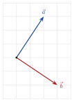

<!-- tillegg: Claude -->
Oppgavene blander skalarprodukt, vinkler og parameterframstillinger. Prøv selv før du åpner løsningen.

:::: {.oppgaver}

::: {.oppgave tittel="Vinkel i trekant" krever="vektorer/skalarprodukt"}
Finn vinkelen $A$ i trekanten med $A = (1, 1)$, $B = (5, 2)$ og $C = (2, 5)$.

::: {.fasit}
$A = 61.9^\circ$
:::
:::

::: {.oppgave tittel="Projeksjon" niva="Middels" krever="vektorer/skalarprodukt"}
Hvor lang er projeksjonen av $\vec u = [5, 2]$ ned på retningen til $\vec v = [3, 4]$?

::: {.fasit}
$4.6$
:::
:::

::: {.oppgave tittel="Møtes de?" niva="Utfordrende" krever="vektorer/parameterframstilling"}
To roboter starter samtidig: A i $(0, 0)$ med fart $[2, 1]$ m/s, B i $(10, -5)$ med fart $[-1, 2]$ m/s. Krysser banene hverandre? Kolliderer robotene?

:::

::: {.oppgave tittel="Står de vinkelrett?" krever="vektorer/skalarprodukt"}
<!-- tillegg: Claude -->
{.tikz-fig style="width:200px"}

Les av $\vec a$ og $\vec b$ (hver rute er 1). Står vektorene vinkelrett på hverandre? Bruk skalarproduktet.

:::

::::
