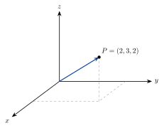

<!-- video: kommer (videoer/matte-forkurs/14-01-vektorer-i-rommet) -->
{fig-alt="Video kommer"}

<!-- tillegg: Claude -->
Den virkelige verden har tre dimensjoner. Et fly har en posisjon nordover, østover og i høyden. Med en tredje akse, $z$-aksen, kan vi bruke nøyaktig de samme reglene for vektorer som i planet. Det eneste nye er en ekstra koordinat.

## Koordinatsystemet i rommet

Vi bruker tre akser som står vinkelrett på hverandre. Aksene er orientert etter **høyrehåndsregelen**: Pek fingrene langs $x$-aksen og bøy dem mot $y$-aksen, så peker tommelen langs $z$-aksen.

{.tikz-fig style="width:340px" fig-alt="Et tredimensjonalt koordinatsystem med x-, y- og z-akse. Punktet P = (2, 3, 2) er tegnet med stiplede linjer ned til xy-planet."}

Et punkt har tre koordinater, $P = (x, y, z)$, og en vektor har tre komponenter:
$$
\vec v = [a, b, c] = a\hat{\mathbf{x}} + b\hat{\mathbf{y}} + c\hat{\mathbf{z}}
$$

## Regning

Alt fra planet gjelder, med én koordinat mer:

::: {.graa}
$$
\overrightarrow{AB} = [x_2 - x_1,\ y_2 - y_1,\ z_2 - z_1] \qquad |[a, b, c]| = \sqrt{a^2 + b^2 + c^2}
$$
Sum, differanse og tall ganger vektor regnes komponent for komponent.
:::

Lengdeformelen er Pytagoras to ganger: først diagonalen i bunnen, $\sqrt{a^2 + b^2}$, så diagonalen opp.

::: {.eksempel}
**Eksempel: Avstand i rommet.** Finn avstanden mellom $A = (1, 2, -1)$ og $B = (4, -2, 11)$.

::: {.losning}
$\overrightarrow{AB} = [3, -4, 12]$, og $|\overrightarrow{AB}| = \sqrt{9 + 16 + 144} = \sqrt{169} = \underline{\underline{13}}$.
:::
:::

::: {.eksempel}
**Eksempel: Drone.** En drone flyr fra $(0, 0, 0)$ med farten $[3.0, 4.0, 1.2]$ m/s. Hvor er den etter $10\ \mathrm{s}$, og hvor stor er farten?

::: {.losning}
$\vec r = 10\cdot[3.0, 4.0, 1.2] = \underline{\underline{(30, 40, 12)\ \mathrm{m}}}$. Farten: $\sqrt{9 + 16 + 1.44} = \underline{\underline{5.1\ \mathrm{m/s}}}$.
:::
:::

## Prøv selv

```{.python .kjor}
import numpy as np
A = np.array([1, 2, -1]); B = np.array([4, -2, 11])
AB = B - A
print(AB, np.linalg.norm(AB))
```

:::: {.oppgaver}

::: {.oppgave tittel="Vektor og lengde"}
Finn $\overrightarrow{PQ}$ og $|\overrightarrow{PQ}|$ når $P = (2, 0, 3)$ og $Q = (4, 6, 6)$.

::: {.losning}
$[2, 6, 3]$, lengde $\sqrt{4 + 36 + 9} = \underline{\underline{7}}$.
:::
:::

::: {.oppgave tittel="Regn ut"}
$\vec u = [1, -2, 3]$ og $\vec v = [0, 4, -1]$. Finn $2\vec u - \vec v$.

::: {.losning}
$[2, -4, 6] - [0, 4, -1] = \underline{\underline{[2, -8, 7]}}$
:::
:::

::: {.oppgave tittel="Midtpunkt" niva="Middels"}
Finn midtpunktet mellom $A = (-1, 4, 2)$ og $B = (5, 0, 8)$, og avstanden fra midtpunktet til origo.

::: {.losning}
$M = (2, 2, 5)$, $|OM| = \sqrt{4 + 4 + 25} = \underline{\underline{\sqrt{33} \approx 5.7}}$.
:::
:::

::::
