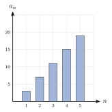

<!-- tillegg: Claude -->
Oppgavene blander aritmetiske og geometriske følger og rekker. Prøv selv før du åpner løsningen.

:::: {.oppgaver}

::: {.oppgave tittel="Hvilken type?" krever="folger-og-rekker/aritmetiske, folger-og-rekker/geometriske"}
Er følgene aritmetiske, geometriske eller ingen av delene? a) $2, 6, 18, 54$ b) $10, 7, 4, 1$ c) $1, 4, 9, 16$

:::

::: {.oppgave tittel="Lønnsøkning" niva="Middels" krever="folger-og-rekker/aritmetiske, folger-og-rekker/geometriske"}
Tilbud A: 500000 kr første år, og 15000 kr mer hvert år. Tilbud B: 500000 kr første år, og 3 % mer hvert år. Hvilket gir mest til sammen over 10 år?

:::

::: {.oppgave tittel="Snøfnugget" niva="Utfordrende" krever="folger-og-rekker/uendelige"}
Kochs snøfnugg starter med en likesidet trekant med areal 1. I hvert steg legges det til nye trekanter: først 3 trekanter med areal $\frac19$, så 12 med areal $\frac{1}{81}$, og så videre (4 ganger så mange, $\frac19$ av arealet). Finn det totale arealet.

::: {.fasit}
$\frac85$
:::
:::

::: {.oppgave tittel="Følgen i søylene" krever="folger-og-rekker/tallfolger"}
<!-- tillegg: Claude -->
{.tikz-fig style="width:240px"}

Søylene viser de fem første leddene i en følge. Hva slags følge er det? Finn $a_n$ og summen av de ti første leddene.

::: {.fasit}
$4n - 1$ · $210$
:::
:::

::::
