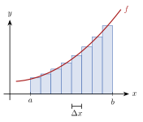

<!-- video: kommer (videoer/matte-forkurs/16-02-bestemt-integral) -->
{fig-alt="Video kommer"}

<!-- tillegg: Claude -->
Hvor langt kjører en bil når farten endrer seg hele tiden? Del tiden i små biter, regn strekning = fart · tid for hver bit, og legg sammen. Jo mindre biter, jo bedre svar. Grensen for denne summen er det **bestemte integralet**, og det er arealet under fartsgrafen.

## Riemann-summer

Del intervallet $[a, b]$ i $n$ biter med bredde $\Delta x = \frac{b - a}{n}$. Over hver bit står et rektangel med høyde $f(x_i)$:

{.tikz-fig style="width:420px" fig-alt="Grafen til en voksende funksjon f fra a til b, med åtte smale rektangler under grafen. Bredden av ett rektangel er merket Delta x."}

::: {.graa}
$$
\int_a^b f(x)\,\mathrm{d}x = \lim_{n\to\infty}\sum_{i = 1}^{n} f(x_i)\,\Delta x
$$
Integraltegnet $\int$ er en strukket S for «sum», og $\mathrm{d}x$ er den uendelig smale bredden.
:::

## Analysens fundamentalsetning

Det er tungvint å regne ut grenseverdier av summer. Heldigvis finnes det en snarvei, og den knytter integrasjon og derivasjon sammen:

::: {.graa}
**Analysens fundamentalsetning.** Hvis $F$ er en antiderivert til $f$, er
$$
\int_a^b f(x)\,\mathrm{d}x = \Big[F(x)\Big]_a^b = F(b) - F(a)
$$
:::

Hvorfor? La $A(x)$ være arealet under grafen fra $a$ til $x$. Øker vi $x$ litt, med $\Delta x$, vokser arealet med omtrent en smal stripe $f(x)\,\Delta x$. Altså er $\frac{\Delta A}{\Delta x} \approx f(x)$, og i grensen $A'(x) = f(x)$. Arealfunksjonen er en antiderivert!

::: {.eksempel}
**Eksempel: Regn ut.** Regn ut $\displaystyle\int_1^3 (x^2 + 1)\,\mathrm{d}x$.

::: {.losning}
$$
\left[\frac{x^3}{3} + x\right]_1^3 = (9 + 3) - \left(\frac13 + 1\right) = \underline{\underline{\frac{32}{3}}}
$$
:::
:::

::: {.eksempel}
**Eksempel: Strekning.** En stein faller fra ro med farten $v = 9.81t$. Hvor langt faller den de første 3.0 sekundene?

::: {.losning}
$$
s = \int_0^{3.0} 9.81t\,\mathrm{d}t = \Big[4.905t^2\Big]_0^{3.0} = \underline{\underline{44\ \mathrm{m}}}
$$
:::
:::

## Prøv selv

Riemann-summen kommer nærmere svaret når $n$ vokser:

```{.python .kjor}
f = lambda x: x**2 + 1
a, b = 1, 3
for n in [4, 10, 100, 1000]:
    dx = (b - a)/n
    S = sum(f(a + i*dx)*dx for i in range(n))   # venstre endepunkt
    print(n, S)
print("Eksakt:", 32/3)
```

:::: {.oppgaver}

::: {.oppgave tittel="Regn ut"}
a) $\int_0^2 3x^2\,\mathrm{d}x$ b) $\int_1^{\mathrm{e}} \frac1x\,\mathrm{d}x$ c) $\int_0^{\pi}\sin x\,\mathrm{d}x$

::: {.losning}
a) $\Big[x^3\Big]_0^2 = \underline{\underline{8}}$ b) $\ln\mathrm{e} - \ln 1 = \underline{\underline{1}}$ c) $-\cos\pi + \cos 0 = \underline{\underline{2}}$
:::
:::

::: {.oppgave tittel="Arbeid i en fjær" niva="Middels"}
En fjær med fjærstivhet $k = 200\ \mathrm{N/m}$ strekkes $0.15\ \mathrm{m}$. Kraften er $F = kx$. Finn arbeidet $W = \int_0^{0.15} kx\,\mathrm{d}x$.

::: {.losning}
$W = \frac12k\cdot 0.15^2 = \underline{\underline{2.3\ \mathrm{J}}}$
:::
:::

::: {.oppgave tittel="Negativt integral" niva="Middels"}
Regn ut $\int_0^2 (x - 2)\,\mathrm{d}x$. Hvorfor blir svaret negativt?

::: {.losning}
$\left[\frac{x^2}{2} - 2x\right]_0^2 = 2 - 4 = \underline{\underline{-2}}$. Grafen ligger under $x$-aksen, og integralet teller areal under aksen som negativt.
:::
:::

::::
