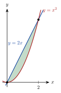

<!-- video: kommer (videoer/matte-forkurs/16-03-areal) -->
{fig-alt="Video kommer"}

<!-- tillegg: Claude -->
Det bestemte integralet regner areal over $x$-aksen som positivt og areal under som negativt. Vil vi ha det faktiske arealet, må vi passe på fortegnet. Og med samme idé kan vi finne arealet mellom to grafer.

## Areal mellom graf og x-akse

::: {.steg}
1. Finn nullpunktene til $f$ i intervallet.
2. Del opp integralet ved nullpunktene.
3. Ta absoluttverdien av hver del, og legg sammen.
:::

::: {.eksempel}
**Eksempel: Graf som krysser aksen.** Finn arealet mellom $f(x) = x^2 - 1$ og $x$-aksen for $0 \le x \le 2$.

::: {.losning}
Nullpunkt i $x = 1$. Antiderivert $F(x) = \frac{x^3}{3} - x$.

$\int_0^1 f\,\mathrm{d}x = -\frac23$ (under aksen) og $\int_1^2 f\,\mathrm{d}x = \frac23 - \left(-\frac23\right) = \frac43$.

Areal $= \frac23 + \frac43 = \underline{\underline{2}}$. (Integralet fra 0 til 2 er $\frac23$, som ikke er arealet.)
:::
:::

## Areal mellom to grafer

::: {.graa}
Ligger $g(x) \ge h(x)$ på $[a, b]$, er arealet mellom grafene
$$
A = \int_a^b \big(g(x) - h(x)\big)\,\mathrm{d}x
$$
øverste minus nederste. Grensene er ofte skjæringspunktene.
:::

::: {.eksempel}
**Eksempel: Linje og parabel.** Finn arealet mellom $y = 2x$ og $y = x^2$.

{.tikz-fig style="width:200px" fig-alt="Linja y = 2x og parabelen y = x i andre skjærer hverandre i origo og i punktet (2, 4). Området mellom dem er skravert."}

::: {.losning}
Skjæringspunkter: $2x = x^2$ gir $x = 0$ og $x = 2$. Linja ligger øverst.
$$
A = \int_0^2 (2x - x^2)\,\mathrm{d}x = \left[x^2 - \frac{x^3}{3}\right]_0^2 = 4 - \frac83 = \underline{\underline{\frac43}}
$$
:::
:::

:::: {.oppgaver}

::: {.oppgave tittel="Under grafen"}
Finn arealet mellom $f(x) = 4 - x^2$ og $x$-aksen.

::: {.losning}
Nullpunkter $\pm 2$. $\int_{-2}^{2}(4 - x^2)\,\mathrm{d}x = \left[4x - \frac{x^3}{3}\right]_{-2}^{2} = \frac{16}{3} + \frac{16}{3} = \underline{\underline{\frac{32}{3}}}$
:::
:::

::: {.oppgave tittel="Sinus" niva="Middels"}
Finn arealet mellom $y = \sin x$ og $x$-aksen for $0 \le x \le 2\pi$.

::: {.losning}
Hver halvbue gir 2. Areal $= 2 + 2 = \underline{\underline{4}}$. (Integralet er 0.)
:::
:::

::: {.oppgave tittel="To grafer" niva="Utfordrende"}
Finn arealet mellom $y = x^3$ og $y = x$.

::: {.losning}
Skjæring i $x = -1, 0, 1$. På $[0, 1]$ ligger $x$ øverst, på $[-1, 0]$ ligger $x^3$ øverst. Symmetri:
$$
A = 2\int_0^1 (x - x^3)\,\mathrm{d}x = 2\left(\frac12 - \frac14\right) = \underline{\underline{\frac12}}
$$
:::
:::

::::
