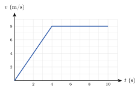

<!-- tillegg: Claude -->
Oppgavene blander ubestemte og bestemte integraler og areal. Prøv selv før du åpner løsningen.

:::: {.oppgaver}

::: {.oppgave tittel="Finn funksjonen" krever="integrasjon/ubestemt-integral"}
$f'(x) = 3x^2 - 2$ og $f(1) = 4$. Finn $f(x)$.

::: {.fasit}
$f(x) = x^3 - 2x + 5$
:::
:::

::: {.oppgave tittel="Gjennomsnitt" niva="Middels" krever="integrasjon/bestemt-integral"}
Gjennomsnittsverdien av $f$ på $[a, b]$ er $\frac{1}{b - a}\int_a^b f(x)\,\mathrm{d}x$. Finn gjennomsnittet av $f(x) = x^2$ på $[0, 3]$.

::: {.fasit}
$3$
:::
:::

::: {.oppgave tittel="Vanntank" niva="Middels" krever="integrasjon/bestemt-integral"}
Vann renner inn i en tank med $r(t) = 20 - 2t$ liter per minutt, for $0 \le t \le 10$. Hvor mye vann har rent inn?

::: {.fasit}
$100\ \mathrm{L}$
:::
:::

::: {.oppgave tittel="Finn grensen" niva="Utfordrende" krever="integrasjon/bestemt-integral, eksponential-og-logaritme/eksponentiallikninger"}
For hvilken $b > 0$ er $\int_0^b \mathrm{e}^{x}\,\mathrm{d}x = 10$?

::: {.fasit}
$2.40$
:::
:::

::: {.oppgave tittel="Strekning fra fartsgraf" niva="Middels" krever="integrasjon/bestemt-integral, integrasjon/areal"}
<!-- tillegg: Claude -->
{.tikz-fig style="width:320px"}

Grafen viser farten til en sykkel. Hvor langt sykler den på de første 10 sekundene?

::: {.fasit}
$64\ \mathrm{m}$
:::
:::

::::
