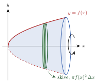

<!-- video: kommer (videoer/matte-forkurs/17-05-integrasjon-og-volum) -->
{fig-alt="Video kommer"}

<!-- tillegg: Claude -->
Snurr grafen til en funksjon rundt $x$-aksen, og du får en romfigur: et **omdreiningslegeme**, som en vase, en kjegle eller en kule. Volumet finner vi ved å skjære figuren i tynne skiver og legge dem sammen, akkurat som vi summerte rektangler for å finne areal.

{.tikz-fig style="width:330px" fig-alt="Grafen til y = f(x) speilet om x-aksen, slik at det dannes en romfigur som roteres om x-aksen. En tynn sirkelformet skive er markert, med volum pi f(x) i andre ganger Delta x."}

## Skivemetoden

Hver skive er en tynn sylinder med radius $f(x)$ og tykkelse $\Delta x$, altså volum $\pi f(x)^2\,\Delta x$:

::: {.graa}
$$
V = \pi\int_a^b f(x)^2\,\mathrm{d}x
$$
:::

::: {.eksempel}
**Eksempel: Parabolsk skål.** Grafen til $f(x) = \sqrt{x}$ for $0 \le x \le 4$ roteres om $x$-aksen. Finn volumet.

::: {.losning}
$$
V = \pi\int_0^4 x\,\mathrm{d}x = \pi\left[\frac{x^2}{2}\right]_0^4 = 8\pi = \underline{\underline{25.1}}
$$
:::
:::

::: {.eksempel}
**Eksempel: Volumet av en kjegle.** Vis at en kjegle med radius $r$ og høyde $h$ har volum $\frac13\pi r^2h$.

::: {.losning}
Kjeglen får vi ved å rotere linja $f(x) = \frac{r}{h}x$ for $0 \le x \le h$:
$$
V = \pi\int_0^h \frac{r^2}{h^2}x^2\,\mathrm{d}x = \pi\frac{r^2}{h^2}\cdot\frac{h^3}{3} = \underline{\underline{\frac13\pi r^2h}}
$$
:::
:::

:::: {.oppgaver}

::: {.oppgave tittel="Rotasjon"}
Grafen til $f(x) = x^2$ for $0 \le x \le 1$ roteres om $x$-aksen. Finn volumet.

::: {.losning}
$\pi\int_0^1 x^4\,\mathrm{d}x = \underline{\underline{\frac{\pi}{5}}}$
:::
:::

::: {.oppgave tittel="Kulevolum" niva="Middels"}
Halvsirkelen $f(x) = \sqrt{R^2 - x^2}$, $-R \le x \le R$, roteres om $x$-aksen. Vis at volumet av kula er $\frac43\pi R^3$.

::: {.losning}
$\pi\int_{-R}^{R}(R^2 - x^2)\,\mathrm{d}x = \pi\left[R^2x - \frac{x^3}{3}\right]_{-R}^{R} = \pi\left(2R^3 - \frac23R^3\right) = \frac43\pi R^3$
:::
:::

::: {.oppgave tittel="Vase" niva="Utfordrende"}
Profilen til en vase er $f(x) = 2 + \sin x$ (dm) for $0 \le x \le \pi$. Hvor mange liter rommer vasen? Bruk $\sin^2 x = \frac{1 - \cos 2x}{2}$.

::: {.losning}
$f^2 = 4 + 4\sin x + \sin^2 x$. $\int_0^{\pi}f^2\,\mathrm{d}x = 4\pi + 8 + \frac{\pi}{2}$.

$V = \pi\left(\frac{9\pi}{2} + 8\right) = \underline{\underline{69.5\ \mathrm{L}}}$ (1 dm³ = 1 L)
:::
:::

::::
