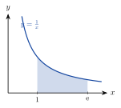

<!-- tillegg: Claude -->
Her må du selv velge metode: variabelskifte, delvis integrasjon, delbrøkoppspalting eller numerisk. Prøv selv før du åpner løsningen.

:::: {.oppgaver}

::: {.oppgave tittel="Velg metode" krever="integrasjonsteknikker/delvis, integrasjonsteknikker/variabelskifte, integrasjonsteknikker/delbrok"}
Hvilken metode passer? a) $\int x\,\mathrm{e}^{-x}\,\mathrm{d}x$ b) $\int \frac{\cos x}{1 + \sin x}\,\mathrm{d}x$ c) $\int \frac{1}{x^2 + 3x + 2}\,\mathrm{d}x$

::: {.fasit}
a) $-(x + 1)\mathrm{e}^{-x} + C$ · b) $\ln(1 + \sin x) + C$ · c) $\ln\left|\frac{x + 1}{x + 2}\right| + C$
:::
:::

::: {.oppgave tittel="Arbeid med variabel kraft" niva="Middels" krever="integrasjonsteknikker/delvis"}
En kraft $F(x) = 10\,x\,\mathrm{e}^{-x}$ (N) virker langs $x$-aksen. Finn arbeidet fra $x = 0$ til $x = 2.0\ \mathrm{m}$.

::: {.fasit}
$5.9\ \mathrm{J}$
:::
:::

::: {.oppgave tittel="Ingen formel" niva="Utfordrende" krever="integrasjonsteknikker/numerisk"}
$\int_0^{\pi}\frac{\sin x}{x}\,\mathrm{d}x$ har ingen elementær antiderivert. Regn den ut numerisk i Python (sett $\frac{\sin x}{x} = 1$ for $x = 0$).

::: {.fasit}
$1.852$
:::
:::

::: {.oppgave tittel="Arealet under 1/x" krever="integrasjon/areal, eksponential-og-logaritme/ln-og-e"}
<!-- tillegg: Claude -->
{.tikz-fig style="width:260px"}

Finn arealet av det skraverte området. Gjør et overslag fra figuren først.

::: {.fasit}
$1$
:::
:::

::::
